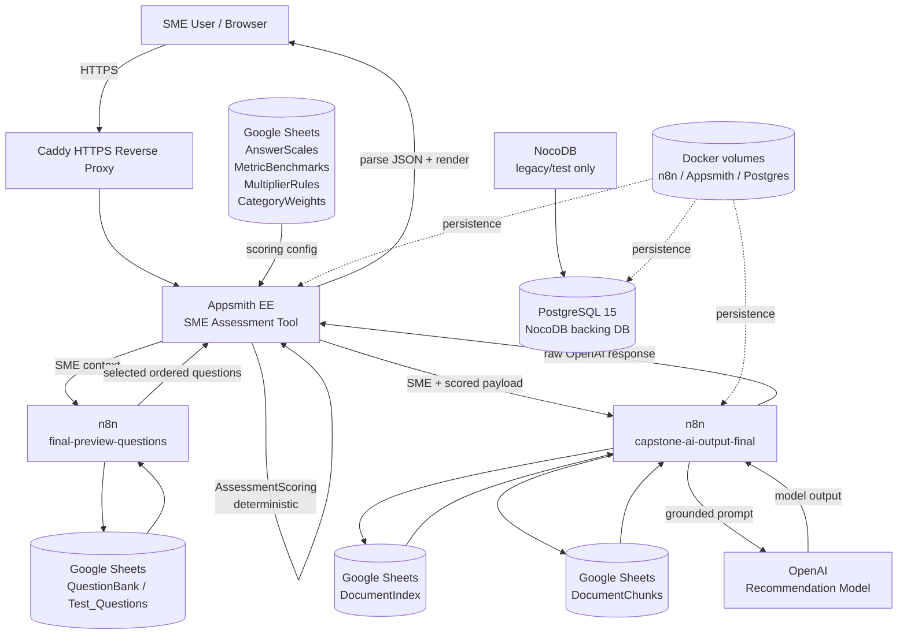

# CURRENT_ARCHITECTURE.md

## Status

Evidence-based reconstruction of the deployed Capstone v1 application.

This document describes **what exists now**. It is not a recommendation that v2.0 reproduce the same technology stack.

For v1 parity, runtime behavior is governed by the preserved Appsmith and n8n exports plus the canonical configuration datasets. The Spring 2026 report is supporting methodology documentation, not runtime authority where it conflicts with the implementation.

---

# 1. System summary

Capstone v1 is a single-server, configuration-driven SME sustainability assessment application.

Its runtime responsibilities are split across:

- **Appsmith EE** — user interface, answer state, deterministic scoring, results rendering;
- **n8n** — question-selection API and recommendation/RAG orchestration;
- **Google Sheets** — authoritative runtime configuration and retrieval datasets;
- **OpenAI** — recommendation generation only;
- **PostgreSQL + NocoDB** — legacy/test infrastructure, not the authoritative production scoring/config store;
- **Caddy** — public HTTPS reverse proxy;
- **Hetzner VPS + Docker** — host/runtime infrastructure.

High-level runtime:

```text
User
  ↓
Caddy / HTTPS
  ↓
Appsmith SME Assessment Tool
  ├── question-selection request → n8n → QuestionBank in Google Sheets
  ├── questionnaire state + deterministic scoring in Appsmith
  │      └── AnswerScales / MetricBenchmarks / MultiplierRules / CategoryWeights
  └── recommendation request → n8n
           ├── DocumentIndex
           ├── DocumentChunks
           └── OpenAI
  ↓
Scores + recommendations rendered in Appsmith
```

---

# 2. Runtime entry point

Authoritative production UI:

`SME Assessment Tool`

The preserved Appsmith export also contains sandbox/development pages. Those are not part of the authoritative v1 runtime contract.

The SME profile contains context including:

- company name;
- industry;
- subindustry;
- employee band;
- revenue band;
- company location;
- country;
- target market region(s);
- target buyer;
- business goal;
- notes.

This context is reused across selection, scoring, retrieval, and recommendation generation, but not every field affects every stage.

---

# 3. Question-selection path

## 3.1 Call

Appsmith action:

`API_Get_Questions`

calls:

`POST /webhook/final-preview-questions`

served by n8n workflow:

`capstone-ai-final`

## 3.2 Source

The final selector reads:

`QuestionBank_Config > Test_Questions`

Despite the tab name, `Test_Questions` is the authoritative final v1 QuestionBank.

## 3.3 Deterministic selection logic

The final v1 selector evaluates:

- `active`;
- `industry_trigger`;
- `market_trigger`, including target-market/company-location matching;
- `size_applicability`.

It then orders selected questions by priority.

### Buyer / business-goal limitation

In v1:

- `target_buyer` does **not** directly select questions;
- `business_goal` does **not** directly select questions.

They do participate elsewhere:

- buyer/goal-targeted multiplier rules can alter adjusted weights;
- target buyer affects RAG relevance;
- business goal participates in recommendation/retrieval context;
- both are supplied to the final recommendation prompt.

---

# 4. Questionnaire state

The user answers the selected questions in Appsmith.

The current implementation stores answer state in Appsmith client/session state and can compute per-question scoring/debug information as answers change.

This front-end state mechanism is an implementation detail. The migration-critical contract is:

```text
selected question
    +
SME answer
    +
current config
    ↓
deterministic normalized / weighted result
```

---

# 5. Deterministic scoring

Authoritative scoring implementation:

`AssessmentScoring`

inside Appsmith.

n8n does **not** own final scoring.

The scoring layer performs:

1. answer normalization;
2. benchmark lookup/fallback for quantitative metrics;
3. base-weight retrieval;
4. contextual multiplier matching;
5. adjusted question weighting;
6. question-level result calculation;
7. category aggregation;
8. industry category weighting;
9. overall score construction;
10. payload construction for the recommendation workflow.

## 5.1 Scoring configuration

Authoritative runtime config datasets:

- `QuestionBank`
- `AnswerScales`
- `MetricBenchmarks`
- `MultiplierRules`
- `CategoryWeights`

The Build Pack preserves these as clean canonical CSVs in addition to raw source artifacts.

## 5.2 Normalization methods represented in v1

The Appsmith scoring implementation includes methods such as:

- direct percent;
- boolean identity;
- Gaussian / target scoring;
- linear cap;
- inverse count;
- inverse percentage;
- benchmark inverse ratio;
- exponential decay;
- inverse linear cap;
- banded scoring;
- min/max normalization.

The exact configuration for a question is driven by `answer_scale_id`, `response_type`, `metric_id`, and related config rather than generated by an LLM at runtime.

## 5.3 Multipliers

The current published MultiplierRules are uplift-only and contain both:

- industry/market-targeted rules;
- buyer/business-goal-targeted rules.

Appsmith multiplies applicable rules and caps the effective multiplier.

This is deterministic configuration logic.

---

# 6. Category and overall scores

The scoring engine produces:

- raw overall score;
- category scores;
- industry-weighted category contributions;
- industry-weighted overall score;
- question-level/debug information;
- highest/lowest questions;
- weakest categories;
- answered-question detail.

The final recommendation payload uses these deterministic outputs as input context.

---

# 7. Recommendation / RAG path

## 7.1 Call

Appsmith action:

`API_Get_Recommendations`

calls:

`POST /webhook/capstone-ai-output-final`

served by n8n workflow:

`capstone-ai-output-final`.

## 7.2 Input

The request contains, at minimum:

- SME context;
- raw overall score;
- weighted overall score;
- category scores;
- weighted category breakdown;
- category/debug information;
- scoring summary;
- answered questions.

## 7.3 Retrieval data

The workflow reads:

- `DocumentIndex`;
- `DocumentChunks`.

These are preprocessed datasets. Runtime v1 does **not** parse PDFs or create chunks.

## 7.4 Document ranking

Document selection is deterministic metadata ranking.

Signals include:

- active status;
- priority;
- industry;
- region;
- buyer;
- topic tags;
- summary/context relevance.

Top **8** documents are retained.

## 7.5 Chunk ranking

Chunks are restricted to the selected parent documents.

Signals include:

- inherited document score;
- chunk strength;
- industry;
- region;
- buyer;
- tags;
- summary relevance.

Top **18** chunks are retained.

The final v1 implementation joins chunks to parent documents using normalized `doc_title`, not a stable document ID.

## 7.6 Model call

n8n builds a grounded recommendation prompt and calls OpenAI.

Current preserved model configuration:

`gpt-5.2`

The model is used to produce:

- executive summary;
- prioritized recommendations;
- key gaps;
- grounding notes;
- source/evidence references.

AI does **not** determine the assessment score.

---

# 8. Recommendation response coupling

The n8n workflow returns the OpenAI node response rather than a clean first-party API schema.

Appsmith then reaches into approximately:

`API_Get_Recommendations.data.output[0].content[0].text`

and parses the contained model text as JSON.

This is a legacy implementation coupling, not a desired product contract.

The desired logical response object is:

```text
executive_summary
priority_recommendations[]
key_gaps[]
grounding_notes
```

with human-readable evidence metadata.

---

# 9. Runtime data ownership

## 9.1 Google Sheets

Google Sheets is the authoritative v1 runtime/config source for:

- QuestionBank;
- AnswerScales;
- MetricBenchmarks;
- MultiplierRules;
- CategoryWeights;
- DocumentIndex;
- DocumentChunks.

For migration, the **data and behavior** are authoritative. Google Sheets itself is an implementation location.

## 9.2 PostgreSQL / NocoDB

Live server inspection found:

- PostgreSQL `postgres` database with no application relations;
- PostgreSQL `nocodb` database containing NocoDB internals;
- one NocoDB user model: `test_smes`.

NocoDB/Test_SMEs belongs to legacy testing/sandbox infrastructure rather than the authoritative production assessment runtime.

---

# 10. Offline preprocessing boundary

The retrieval/config datasets were produced upstream of runtime.

Preserved provenance indicates:

## NotebookLM

Initial document-by-document extraction was used for:

- AtomicIndicators;
- DocumentIndex;
- DocumentChunks.

A fresh NotebookLM session/window per source document is explicitly confirmed for AtomicIndicators.

## Claude

Subsequent AtomicIndicator transformations included:

- normalization / cleanup;
- clustering;
- cluster rejoin;
- frequency/context enrichment;
- base-weight generation;
- QuestionBank transformation stages.

These preprocessing steps are not invoked by a v1 assessment session.

---

# 11. Deployment architecture

Host:

`capstone-ai` on a Hetzner VPS.

Host-level service:

- Caddy

Docker services:

- `ai-capstone_postgres_1`
- `ai-capstone_nocodb_1`
- `ai-capstone_n8n_1`
- `appsmith`

Docker network:

`ai-capstone_default`

Persistent named volumes:

- `postgres_data`
- `n8n_data`
- `appsmith-stacks`

Public Caddy routes:

- `n8n.flowagentai.website` → `127.0.0.1:5678`
- `appsmith.flowagentai.website` → `127.0.0.1:9080`

The current Compose configuration also directly publishes PostgreSQL, NocoDB, n8n, and Appsmith ports on host interfaces. This is current-state evidence, not a v2 requirement.

---

# 12. External dependencies

Current application/business-logic dependencies include:

- Google Sheets / Google APIs;
- OpenAI API;
- DNS for `flowagentai.website`;
- Hetzner VPS;
- Docker;
- Caddy.

Platform-specific Appsmith auxiliary services/keys may also exist, but they are not Capstone domain requirements.

---

# 13. Credential boundary

Secret-bearing values are not preserved in the Build Pack.

Important credential/config classes include:

- PostgreSQL credentials;
- `NC_DB`;
- `N8N_ENCRYPTION_KEY`;
- Google credential(s) in n8n;
- OpenAI credential in n8n;
- Appsmith runtime/vendor keys.

The real `N8N_ENCRYPTION_KEY` is especially important if the existing n8n credential store ever needs to be restored.

---

# 14. Known legacy implementation quirks

The following are evidence-backed migration flags:

1. final QuestionBank tab is named `Test_Questions`;
2. buyer and business goal do not directly select v1 questions;
3. unrecognized size applicability can fall through as included;
4. scoring resides in Appsmith rather than n8n;
5. chunks join to documents by normalized title instead of stable `doc_id`;
6. duplicate chunk IDs exist across different documents;
7. exact DocumentIndex/DocumentChunks title mismatches exist;
8. retrieval is metadata-based, not vector/embedding-based;
9. recommendation JSON is enforced through prompt instructions rather than a strict response schema;
10. Appsmith is coupled to the raw OpenAI node response shape;
11. Appsmith loading-stage labels are simulated UI state, not true backend progress;
12. NocoDB/Test_SMEs is test infrastructure rather than production data ownership;
13. several Docker service images are not pinned to immutable versions.

These should be regression-tested or deliberately changed rather than accidentally inherited.

---

# 15. Architecture diagram

See:

`CURRENT_ARCHITECTURE.mmd`

Canonical diagram:



---

# 16. Migration-critical contracts

The technologies may change. These contracts should not change accidentally:

## Question-selection contract

```text
SME context
    ↓
deterministic applicability rules
    ↓
ordered applicable question records
```

## Scoring contract

```text
SME answer
+ question metadata
+ answer scale / benchmark
+ base weight
+ applicable multipliers
+ category weight
    ↓
deterministic question/category/overall scores
```

## Recommendation contract

```text
SME context
+ deterministic scores
+ answers
+ retrieved evidence
    ↓
grounded recommendations / gaps / evidence
```

## Configuration contract

Assessment behavior is configuration-driven and auditable. Runtime AI should not silently replace deterministic scoring decisions.

---

# 17. Source artifacts used to reconstruct this architecture

Primary preserved artifacts include:

- Appsmith export: historical label `Sandboxes.json`; preserved as `02_LEGACY_APPSMITH/export/appsmith-sandboxes-v1-export-2026-10-02.json`;
- Appsmith UI/behavior inventory: `APPSMITH_COMPONENT_MAP.md`;
- n8n question-selection export: historical label `capstone-ai-final.json`; preserved as `03_LEGACY_N8N/workflows/n8n-question-selection-final-2026-10-02.json`;
- n8n recommendation export: historical label `capstone-ai-output-final.json`; preserved as `03_LEGACY_N8N/workflows/n8n-output-rag-final-2026-10-02.json`;
- `workflow_inventory.md`;
- `webhook_inventory.md`;
- `04_CONFIG/raw/*`;
- `04_CONFIG/clean/*`;
- `06_AI_RAG/AI_PIPELINE_CURRENT.md`;
- `06_AI_RAG/prompts/*`;
- `05_DATABASE/DATA_MODEL_CURRENT.md`;
- `05_DATABASE/nocodb/README.md`;
- `09_DEPENDENCIES/ENVIRONMENT_VARIABLES.md`;
- `09_DEPENDENCIES/EXTERNAL_SERVICES.md`;
- `08_ARCHITECTURE/deployment/DEPLOYMENT_CURRENT.md`;
- redacted Docker Compose and Caddy configuration.

