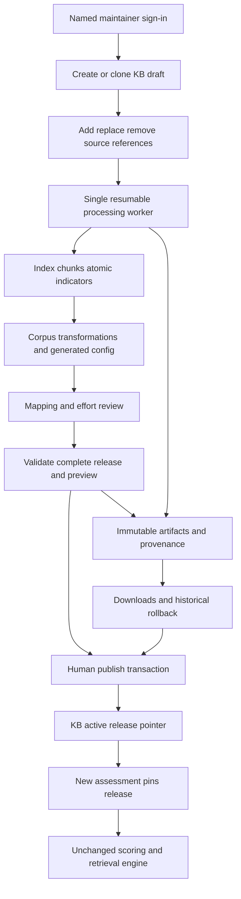

# M6 administrator and knowledge-base workflow — planning handoff

Current status: owner-approved CM-2026-11-15-01 executed on15 November2026. Exactly67 listed images removed;6.725GB reclaimed,7.426GB available. Live health and rollback availability verified; all281 unlisted images retained. See cleanup execution closeout at the end. Admin/workflow proposals remain planning only.

Latest refinement: see “Focused follow-up — storage remedy and transformation recovery” below. Its source-linked first-package scope supersedes the broader initial package wording where they differ.

Prepared 15 November 2026 (Asia/Bangkok). Status: proposal for owner review; no implementation authorization inferred.

## Recommendation

Build one restricted maintenance area in the existing Next.js application around **draft → process → exceptions → preview → publish**. A release is an immutable, auditable package, not a collection of independently live tables. Keep the deterministic engine and its seven canonical entities intact.

Use named maintainers signing in with an existing identity provider, a small transactional metadata store, private content-addressed files, and one resumable maintenance worker using the same codebase. No public registration, respondent database, general generated-table editor, separate vector service, Redis, or enterprise roles.

The first implementable package should be a **protected release foundation**: import the preserved baseline, clone a draft, validate it, preview it, download its artifacts, publish it atomically and roll it back. This supplies the durable destination for the later source-to-config pipeline; it must not be presented as completion of automated regeneration. Source edits may be staged but cannot publish a misleading combination of changed sources and unchanged derived scoring configuration.

The immediate operational constraint is disk capacity: the current server has only 701,345,792 bytes available (669 MiB), at 99% usage. Resolve operational headroom under separate authorization before deploying any M6 component.

## Authority, isolation and evidence limits

- Read the live Build Checklist v2.0 F1 value/note and M6.1–M6.9 values/notes on 15 November. These are currently rows 35–43. All nine completion boxes were false. Latest request authorizes discovery/planning and a saved handoff only. No checklist write.
- Source: [Build Checklist](https://docs.google.com/spreadsheets/d/1JPxxDzxOuH77i62EUBqgz9T46h-8ck9YtKZQIQa8FdQ/edit?gid=406102921).
- Reviewed relevant Charter, Scope, Product Vision, IP guardrails, Legacy Map, BUILD_PLAN, EXECUTION_PLAN, prompting memory, ADR 0001, config/runtime code and preserved generation prompts.
- Created isolated managed worktree: C:/Users/guyli/.codex/worktrees/m6-admin-planning/2.0_BUILD_PACK. Detached base 31d708226f2c1dadae1b0b0bcc3e10ff51eab6f8. This is an older M4 checkpoint, **not current deployed main**. This handoff is the only intended new file there; do not implement against this old base without reconciling updated main.
- App inventory identifies “MOSAIC Main” at C:/Users/guyli/.codex/worktrees/m5-live-clarification/2.0_BUILD_PACK/BUILD_PACK. Its files were read only; no edits, checkout, build, tests, process changes or server restart.
- Read newer Quick assets in BUILD_PACK/.m8-preprocessing and measured deployed files separately. Do not equate one worktree's committed HEAD with MAIN's dirty development state.
- Server inspected through existing SSH access, only read-only OS/Docker/file-size commands. No Docker Desktop, builds, cleanup, installation, paid processing or infrastructure purchase.
- Current running release observed: mosaic-3649a37927df5bc1d1d2, image a114bc170461. No deployment performed. Runtime source/config measurements below come from its release directory and running container.

## 1. Capacity: measured facts and usable planning bounds

Server sample began 2026-11-15 15:06:57+07. Values are point-in-time, not stress-test capacity.

| Area | Measured observation |
| --- | --- |
| Root filesystem | 39,956,590,592 bytes capacity; 37,599,576,064 used; 701,345,792 available; df reports 99% |
| Host memory | 4,005,441,536 bytes total; 3,220,414,464 available; no swap |
| CPU/load | 2 logical CPUs; load averages 0.09 / 0.05 / 0.01 |
| Running app | Healthy, up 2 days; sampled CPU 0.01%; memory 143 MiB against 768 MiB container limit |
| Containers | Docker reports 2 total, 1 running; combined writable layers approximately 24.58 kB |
| Images | 37 images; Docker reports 31.27 GB; current image displayed size 2.77 GB; previous image 2.66 GB |
| Actual image storage | /var/lib/containerd = 31,284,281,344 allocated bytes, including content 9,003,802,624 and overlay snapshots 22,270,992,384 |
| Release directories | /opt/mosaic-app/releases = 2,458,791,936 allocated bytes; current release directory 72,466,432 allocated bytes |
| Archives | /root total 726,790,144 allocated bytes; multiple retained release/source tar files, individually about 1.8–164.9 MB |
| Logs | /var/log = 900,648,960 allocated bytes; journal = 647,802,880 |
| Cache/volumes | Docker build cache reported 0; Docker local volumes 0; /root/.cache 4,096 allocated bytes |
| Durable app mount | /opt/mosaic-app/budget → /budget, read/write; 12,288 allocated bytes on host. Preserve existing usage ledgers |
| Databases | No running database container; /var/lib/postgresql and /var/lib/mysql absent. No application DB dependency in inspected baseline package |
| Runtime directories | node_modules 386,195,456; .next 67,919,872; config 1,662,976; public 161,521,664 allocated bytes |

Do not add individual image sizes to estimate reclaimable disk: layers can be shared. Docker emitted an impossible negative reclaimable total (-9%); that field is unusable. The very small /var/lib/docker size is not the image footprint on this host; containerd owns the substantial storage.

The current source tree has 1,818,623 logical bytes in 127 src files; public assets have 161,259,398 logical bytes in 95 files. Logical and allocated bytes differ, so the current release's 72.5 MB allocated size is not a contradiction or a safe unpack/build allowance.

Build procedure inspected: npm ci, Next build, pruning and a multistage runtime image; current runtime also installs Chromium for PDF export. Measured installed runtime/image sizes are above. **Peak build disk/RAM, development dependency footprint and temporary build-layer growth were not measured.** No build was run. 669 MiB available is not an adequate demonstrated build reserve; neither a successful future build nor a precise required free-space figure can be promised.

### Current KB and pipeline artifact inventory

| Artifact | Records / logical bytes |
| --- | --- |
| DocumentIndex | 44 / 40,948 |
| DocumentChunks | 428 / 778,823; all string fields total 604,560 UTF-8 bytes, including metadata and repeated labels |
| QuestionBank | 161 / 165,955 |
| AnswerScales | 39 rows / 7,152 |
| MetricBenchmarks | 62 rows / 29,261 |
| MultiplierRules | 42 / 24,772 |
| CategoryWeights | 5 / 2,646 |
| Manifest | 2,795 |
| Seven canonical JSON entities plus manifest | 1,052,352 bytes, about 1.004 MiB |
| All deployed config, including supplementary profiles/mappings | 27 files / 1,571,899 bytes |
| Preserved atomic stage CSVs, local baseline | 12 files / 3,386,335 bytes |
| Preserved prompt/provenance Markdown, local baseline | 16 files / 44,827 bytes |
| Original and normalized atomic rows | 1,172 each; normalized version adds normalization_notes |
| Quick published effort/profile JSON | 127,072 + 417 bytes, already within all-config total |

The 44 index entries identify sources and links; they are **not evidence that 44 original source files are stored locally**. A complete source corpus and its total bytes were not located in the inspected baseline/deployed package. Full extracted text separate from selected evidence chunks was also not located. Report PDFs/website media are not substitutes for the indexed corpus. There is no vector-index artifact in the inspected runtime; retrieval ranks the JSON document/chunk records directly.

### Storage for 1, 5 and 20 current-sized KBs

A numerical total for full-source KBs cannot be established without original source/text measurements. Use this explicit conditional model instead of inventing a mean PDF size:

- D = 5,003,061 bytes = deployed config + local stage CSVs + prompt provenance. This deliberately retains all measured derived/provenance artifacts; it is a planning reference, not a measured complete release package.
- S = original source-file bytes per current-sized corpus, unknown.
- T = full extracted text/OCR output beyond retained chunks per corpus, unknown.
- X = S + T + D.
- Assumptions: three retained published versions and one draft per KB; no cross-version/cross-KB deduplication credit; a separate permanent baseline; one worker with temporary space of two full package equivalents. All versions conservatively treated as full-sized.
- Primary disk envelope = (4N + 3) × X. One complete independent backup copy of durable content adds (4N + 1) × X **off host**. Backup temporary space, metadata DB growth, job transcripts and indexes must be measured separately; no compression savings assumed.

| KBs | Measured-artifact component of primary envelope | Plus unknown source/text component | One off-host backup's measured-artifact component |
| --- | --- | --- | --- |
| 1 | 35,021,427 bytes / 33.4 MiB | 7 × (S + T) | 25,015,305 bytes / 23.9 MiB, plus 5 × (S + T) |
| 5 | 115,070,403 bytes / 109.7 MiB | 23 × (S + T) | 105,064,281 bytes / 100.2 MiB, plus 21 × (S + T) |
| 20 | 415,254,063 bytes / 396.0 MiB | 83 × (S + T) | 405,247,941 bytes / 386.5 MiB, plus 81 × (S + T) |

These are artifact-only lower components of a conditional envelope, **not claims that 20 full KBs fit**. Three versions is an initial capacity scenario, not permission to erase older releases. If every historical release is retained, add one X for each further distinct full version. Content hashes can share unchanged blobs safely: replace repeated S/T/artifacts with the union of referenced hashes when actual overlap is known. Cloning then copies metadata, not documents. Do not budget assumed deduplication percentages.

Application code/image is shared across KBs and is not multiplied by N. New documents, versions, processing artifacts and backups grow with KB usage. Current disk growth is dominated by retained images/releases and assets, not the roughly 1 MB canonical KB.

### Practical storage and backup choices

1. **Recommended initial location:** host-local persistent data outside image/release directories, with a transactional metadata DB and hash-addressed files. First obtain approved headroom through a reviewed retention/cleanup operation or a storage expansion decision. No cleanup executed here.
2. Retain known-good current/previous deployment images and explicitly protected incident/rollback evidence. Inventory references before proposing removal of older images/archives; do not offer a blanket prune command.
3. If original documents are large, a separate attached volume isolates data from build pressure; it remains the same failure domain unless independently backed up.
4. Object storage is a later option for larger corpora or independent backups. It adds credentials, cost and restore procedures; no need to introduce it merely for the current JSON volume.
5. Existing rollback files include release.previous.env and multiple dated rollback directories; previous APP_IMAGE is a63e80995309bc70e42393fbc3bd65daa24888d5e7d213a124840b153f1218c8. These are deployment rollback aids, not proof of a complete data backup.
6. No app backup directory, root cron backup job or app-specific systemd backup timer was found. /var/backups contains OS material (1,703,936 allocated bytes). Provider snapshots/off-host backups and retention are unverified.
7. Proposed M6 policy: immutable baseline and all published manifests/artifacts retained initially; drafts deletable; bounded temporary/retry output retention; consistent DB backup plus referenced blobs to an independent destination; restore verification before release. Seven daily/four weekly backup snapshots is a proposed policy requiring storage sizing, not an observed practice. The table above budgets only one copy, not that retention schedule.

## 2. Existing implementation and reusable assets

| Area | Reusable now | Incomplete / missing |
| --- | --- | --- |
| Runtime config | app/src/adapters/config-repository.ts validates checksums, record counts, Zod shapes and references, returning immutable CanonicalConfig | loadCanonicalConfig hard-codes config/capstone-v1; ConfigRepository.load() has no KB/release argument |
| Deterministic engine | Explicit configuration input; selection, normalization, weights, multipliers, traces | New release compatibility needs version-aware composition, not formula changes |
| Assessment session | Browser sessionStorage, configVersion checks, visible save/incompatibility errors | Single storage key and rejection of incompatible current config are not historical release resolution |
| APIs / results | Server recomputation from trusted config; separate recommendation provider; newer score/Quick/report/Levers routes | Each must resolve the same pinned release; report/Quick/portrait/calculator dependencies must not silently use current global files |
| Retrieval | DocumentIndex/DocumentChunks, deterministic metadata ranking; stable migrated document/chunk IDs | No source ingest service, persistent search/vector index or KB selection |
| Persistence/security | Durable hosted budget ledger with reservation/settlement; same-origin and request limits | No named-admin auth, admin DB, job scheduler, release catalog or publishing UI in inspected code; budget protection is not authentication |
| Migration | app/tools/migrate-config.ps1, clean CSVs, explicit identity map, manifest generation | One-time baseline migration with nine known title mismatches; not a general source-processing engine |
| Extraction | NotebookLM prompt files for atomic indicators, source index and evidence chunks; 1,172 atomic rows preserved | Manual per-document procedure, not an automated reproducible parser/OCR/extractor |
| Transformation | Cluster, frequency/context, base-weight, QuestionBank steps 1–3, multiplier and category prompts; intermediate CSVs | No complete executable end-to-end generation chain; missing standalone normalization and cluster-rejoin prompts; later QB variants → production QA lineage not fully verified |
| Quick effort | experiments/m8.0-v1 prepare/classify/compare scripts, prompt, proposals, review/audit files; runtime question hashes and effort profile | Bounded experiment, not a generic production job. Paid script's old allowance is exhausted/non-transferable; many assignments retain provisional/pending review status |

Important methodology gaps:

- Base-weight prompt explicitly combines 0.75 coverage rank + 0.25 frequency rank, then 1 + 4 × score, rounded to two decimals, using separate universal/industry/market pools. Preserve this generating method; do not derive weights from table names.
- The preserved frequency prompt defines counts/percentages but does not fully supply all coverage fields required by the weight prompt. Resolve coverage denominators, contextual source membership, percentile/tie conventions, singleton/empty pools and any intervening transformation before claiming exact reproduction.
- Category-weight prompt specifies category proportions and 0.10–0.50 smoothing; edge cases and redistribution must be reconciled with preserved outputs rather than invented.
- Atomic schema includes source identity, framework, text, category, response type, applicability, size relevance, tags, evidence excerpt and notes. Add stable artifact/page lineage without overwriting preserved original fields.
- Multiplier prompts and QA changes are methodology provenance, not permission for new rules. MetricBenchmarks were researched; source frequency cannot regenerate benchmark values.
- Pin prompt bytes/hashes, model/settings, inputs, code/schema versions and output artifacts. Replay of stored outputs can be reproducible; fresh model generations cannot be promised byte-identical.

### Quick assessment inside the same pipeline

After candidate questions and answer mappings stabilize, run the existing effort-classification concept as one versioned stage. Classes: direct_knowledge, record_lookup, calculation_aggregation, needs_review. Reuse only approved classifications whose question **and relevant answer context** hashes match; retain proposal, rationale, assumptions, model/prompt/rule version and reviewer/date. Reflag changes rather than carrying stale approval.

The current runtime already checks question-content hashes and imports quick-effort-v1.json and quick-v1.json statically. Move those artifacts into the release resolution path; no separate preprocessing product. Existing provisional assignments stay provisional. A new release may support Full while withholding Quick if required effort review is unresolved; that capability flag must be explicit. Preserve the accepted Quick selector/method and distinguish Quick scores from Full. Apply the same completeness rule to portrait mappings and calculator mappings: reuse validated compatible mappings or disable the affected optional capability visibly, never attach old question IDs blindly.

## 3. Smallest coherent architecture

Proposed ADR: **SQLite on host-local disk plus typed migrations/repositories and immutable files**, subject to owner approval because M6.1 currently anticipates PostgreSQL/Drizzle. SQLite fits a few maintainers, one worker and one host; transactions are needed for job claiming, budgets and atomic activation. Plain loose JSON files alone would require hand-built concurrency/recovery logic. Keep Drizzle or an equivalently explicit reviewed typed adapter; pick compatible versions during implementation authorization, not now.

PostgreSQL/Drizzle remains a valid alternative if already required by hosting policy or if multiple app hosts/concurrent workers become necessary. It adds an operated service without an evidenced current workload need. Do not use network-shared SQLite. SQLite WAL supports readers alongside a writer but only one writer at a time; keep transactions short and never hold one during a model call. Use its supported online backup mechanism, not an arbitrary copy of a live DB. [SQLite usage guidance](https://www.sqlite.org/whentouse.html), [WAL](https://www.sqlite.org/wal.html), [backup API](https://www.sqlite.org/backup.html).

Authentication recommendation: **Better Auth with one existing Google or institutional OIDC provider and a named-admin allowlist**. Official Next.js integration and OAuth identity validation provide a supported library route; select and pin a supported version against the actual app before installation. Use provider identity (issuer/subject), verified identity details and local enabled-admin status; do not authorize an entire email domain. Provision approved maintainers explicitly; deny unlisted identities before account creation and check enabled status on every privileged operation. No email/password registration or organization plugin. No shared administrator password. [Next.js integration](https://better-auth.com/docs/integrations/next), [OAuth](https://better-auth.com/docs/concepts/oauth).

Use library-managed secure cookies/sessions, configured trusted origin/callback, expiry/revocation and anti-CSRF protections. Protect services as well as pages: upload, processing, exception changes, preview, downloads, publication and rollback each check authorization server-side. Provider credentials stay server-side. A small “enabled maintainer” role is sufficient; actor audit records replace elaborate approval hierarchies. An admin may review and publish, but publication requires an explicit human action. Verify provider egress under the existing fail-closed network policy before eventual deployment; no firewall change now.

### Data records and boundaries

- KnowledgeBase: stable ID, slug, title, lifecycle, current published release ID; a singleton default-KB pointer for /assessment.
- Draft: KB ID, parent release, revision number, selected source revisions, state; optimistic concurrency prevents lost edits. A job targets a frozen draft revision.
- SourceRevision/Artifact: source identity, content hash, byte size, type, citation, source year/license, uploaded by/date; private blob path. Replacements create revisions; removal affects draft membership only.
- ProcessingRun/StageAttempt: input manifest hash, stage/version, state, progress counts, output hashes, attempts, timestamps, safe failure reason, budget reservations/actuals, lease/heartbeat.
- ReviewDecision: question/metric/scale identity, dependency hashes, proposed match, exact/proxy/incompatible status, rationale, evidence, actor/time; append-only history.
- Release: immutable ID/manifest hash, schema/method/prompt versions, canonical artifact references, source set, pipeline lineage, validation report, approved exceptions, capability artifacts, publisher/date.
- Admin identity/session records and append-only audit events. **No assessment answer/submission table.**

Retain QuestionBank, AnswerScales, MetricBenchmarks, MultiplierRules, CategoryWeights, DocumentIndex and DocumentChunks as independent named artifacts in the package. Add supporting effort, setup/profile, portrait/calculator mappings and retrieval-policy compatibility references; never silently merge their semantics into one generalized table.

Upload writes are bounded/quarantined with explicit file types, size/page limits and safe filenames. No arbitrary source-URL fetch or scheduled crawling in the first version. Parse untrusted content with resource limits; source text never supplies tool instructions. Artifact downloads are authorized and license-aware, with safe archive paths. Public assessment payloads contain only required catalog/evidence material, not private full-source files.

### Incremental processing and recovery

1. Hash source bytes and the relevant extractor/prompt/schema versions. Reuse matching successful per-source index/chunk/atomic artifacts; process only changed/new documents. Removing a source removes it from the selected corpus, not historical releases.
2. Recompute corpus-dependent clustering/coverage/frequency, weighting and generated configs over the entire selected KB. Do not patch only the new document's weights; corpus denominators and cluster membership can change globally. Reuse global outputs only for an identical complete input manifest.
3. One worker from the same app image polls/claims DB jobs; no external queue. This process is justified because long work must survive HTTP timeouts/restarts. One active processing job initially; no in-request/background promise pipeline.
4. Persist checkpoints and output hashes before marking a stage complete. On restart, use lease expiry and idempotent input keys. Resume completed work without repeating paid calls; uncertain dispatch outcomes retain reservation and require review rather than blind retry.
5. Show real stage/count progress, failed stage and actionable reason. Enforce per-run, per-stage and daily ceilings, input/output limits, bounded retries, cancellation and disk reserve before dispatch. Use a separate admin-processing budget; do not spend/reset public or exhausted experiment ledgers.
6. No dollar estimate for full regeneration is defensible yet: source bytes/token volume and recovered stage contracts are missing. Display a conservative request reservation and require a separately approved cap before the first live run.

### Atomic publication, routes and reproducibility

Write and verify all immutable blobs first. Validate the exact draft revision and dependency hashes. A single DB transaction creates/seals the release and switches the KB pointer with compare-and-swap on the expected previous release. Concurrent edits invalidate readiness; partial uploads or failed validation cannot change live state. On failure, the previous complete release remains selected.

- /assessment resolves the default KB's published release.
- /assessment/[kb-slug] resolves another KB. Existing /assessment can coexist with the dynamic child; no such child was found in inspected routes.
- /assessment/[kb-slug]?release=<immutable-id> provides a reproducible published reference. Resolve only IDs belonging to that KB; never treat parameters as file paths. Unknown/unpublished versions fail explicitly.
- Initial page/runtime catalog loading must be dynamic or release-keyed; the present build-time load cannot support deploy-free KB publication unchanged.
- Browser session key and payload pin kbId + releaseId + manifestHash + applicable profile/method versions. Existing assessment answers remain in sessionStorage.
- Score, recommendation, Quick, Levers, guided-entry transfer and report requests resolve this exact release; all caches/results/attempt identities include it. Server loads trusted artifacts and rejects mismatches, never trusts a client-provided configuration.
- Existing /results must carry/resolve the pinned KB/session rather than choosing whichever global session is newest. Existing single-KB sessions need an explicit migration to the baseline reference, with no silent answer remapping.
- Publish B while an assessment is using A: new sessions use B; existing sessions continue A. Downloads identify the release and method versions. A new KB requires no application deployment once this resolver exists.
- Rollback switches the pointer to a retained validated release with an audit reason; it does not rewrite release contents or revert app/budget history. Schema/engine compatibility must be checked before activation.
- Unpublished drafts may be deleted when jobs are stopped and no published artifact depends on them. Released KBs are archived/unpublished, not hard-deleted; retain historical references. Stop new default starts when unpublished while allowing known-version interpretation under the approved retention policy. Never reuse a historical slug for a different KB.

## 4. Focused benchmark and answer-mapping review

Generated tables are read-only outputs. The maintenance UI offers exception forms for mappings and researched benchmark/scale records, not arbitrary editing of generated question wording, weights, multipliers or categories.

For each question determine its normalization path first:

- Boolean/categorical questions normally require an active compatible AnswerScale, valid options and scoring mapping; they do not automatically require a numeric benchmark.
- Numeric/percent/computed questions require the metric/normalization contract actually used by the engine. Some normalization modes use identity parameters, others require researched ranges/targets. Do not invent an external benchmark merely because an answer is numeric.
- Check metric identity, unit/dimension, numerator/denominator, currency/base year where relevant, reporting period/basis, industry/geography/context, direction, normalization function/parameters and applicability/precedence. Ambiguous multiple matching benchmarks are exceptions, not “first row wins.”

Exception screen: question and intended answer → unresolved dependency → candidate mappings and evidence → compatibility differences → resolution. Candidate rankings may assist but do not authorize mappings. Label approximate/proxy matches explicitly; absence of evidence is not compatibility.

Admin actions: choose a proven compatible existing metric/scale; correct a question's mapping; create or amend a researched benchmark with required citations/rationale; or defer. Record source URL/document/page, source year, units/basis, applicability, reviewed/due dates, review status and reviewer. Existing benchmarks are provisionally 2026-relevant by owner assumption, **not verified 2026 source data**; missing citations remain missing. Review-due dates follow an explicit policy, not inferred expiry.

Overrides are a separate versioned overlay tied to question and dependent metric/scale content hashes. Regeneration reapplies only still-valid decisions; changed wording, denominator, scale options, benchmark content or applicability reopens review. Validate all dependent questions/references after an edit and show the impact, including other uses of a shared scale. Published releases remain unchanged.

Example (illustrative only; no benchmark created): a new question asks annual water use per tonne of output. The closest existing candidate is water use per revenue. The UI flags a denominator mismatch and disallows treating it as an exact match. Admin either supplies a cited water-per-tonne benchmark with compatible industry/year/units/normalization and reviews its parameters, or leaves the exception unresolved. No manufactured value or guessed conversion. A boolean “Do you have a water policy?” question instead maps to the approved Yes/No scale and needs no water-intensity benchmark.

**Recommended publication policy for owner decision:** block publication while an active scored question has an unresolved required mapping; draft preview can show the exception but must not issue a complete score. This preserves the intended question set. Alternative: explicitly exclude affected questions with recorded status and coverage disclosure. That changes the assessment universe/denominators and comparability, so it requires methodology approval; do not silently implement it as an error-handling fallback. Optional Quick readiness may be withheld separately without pretending Full mappings are resolved.

Show due/stale/missing-provenance alerts inside admin first. M6.3's 7 November note also requires freshness emails: retain that as a later tracked deliverable with recipients/cadence/transport decisions. Today's request defers notifications; do not mark that requirement complete or build scheduled/email services now.

## 5. Checklist reconciliation and staged delivery

| Current task / row | Proposed work and dependency correction | Concrete acceptance criteria |
| --- | --- | --- |
| M6.1 / 35 — Persistence + config/version data model | ADR plus release/draft/source/job/review schema. SQLite is a proposed alternative to recorded likely PostgreSQL/Drizzle, not a silent change | Clean migration creates store; baseline hashes/counts preserved; data access isolated; no respondent records; two KB identities supported |
| M6.2 / 36 — Protected maintainer/admin boundary | Named-admin provider login, allowlist, server authorization and revocation | Unlisted/disabled users cannot read private artifacts or mutate/process/publish via direct requests; each action identifies actor; public assessment remains account-free |
| M6.3 / 37 — Import, staging + validation | Controlled package import and exception-specific benchmark/scale forms. General table editing superseded by current clarification | Invalid package cannot activate; units/references checked; draft-only edits audited; stale overrides reopen; alerts present. Emails explicitly deferred |
| M6.4 / 38 — KB/source maintenance | Create/clone KB, add/replace/remove source revisions, artifact downloads and source validation | Clone preserves shared hashes; source revision does not alter live release; source/config derivation status visible; incomplete changed-corpus package cannot publish |
| M6.5 / 39 — Activation + fallback | Full-package activation, runtime release resolution, pinned sessions, rollback | A→B publish leaves existing A sessions reproducible; all endpoints use correct version; new KB slug works without rebuild; baseline rollback and downloads verified |
| M6.6 / 40 — Maintenance security/deployment + review | Approved checks, clean-clone migration and backup/restore rehearsal; capacity first | Restored DB+blobs reproduce manifest hashes; failure leaves last live release; admin/upload boundaries verified; owner accepts before controlled deployment |
| M6.7 / 41 — Scope/IP gate | Explicit human/Prof. Guo scope/IP approval for automated regeneration | Recorded approval identifies research boundary, allowed corpus/provider/data handling and method owner; no implied permission from this plan |
| M6.8 / 42 — Automated source→config pipeline | Dependency says M6A.0: replace conceptually with M6.7; recover missing method first | Authorized small real source set completes recorded stages; unchanged per-source artifacts reused; corpus weights recomputed; restart resumes; budget cannot overspend; mappings/effort exceptions surface |
| M6.9 / 43 — Generated review/publish/rollback | Dependency says M6A.1: maps to M6.8, plus M6.5–M6.6 release controls | Admin reviews generated complete package, preview and provenance; explicit publication, pinned assessment and rollback demonstrated; unresolved-policy enforcement verified |

M6.4's “belongs to M6A” note should point to M6.7–M6.9. M6.9's output still says “M6A review package”; rename during PM reconciliation. Repository M5/M5A and M6A historical headings remain evidence, not current step IDs. M6.5 “assessment records store version” should mean the existing browser session/report/request reference here, not a newly authorized SME submission database.

Recommended delivery order, one separately accepted package at a time:

1. **Protected release foundation (first implementation proposal):** M6.1–M6.2 plus a narrowly scoped vertical slice of M6.3/M6.5. Baseline import → clone → validate → authenticated preview/download → publish/rollback; second KB may clone approved baseline solely to verify routing. No generated-table editor, no paid extraction. Record partial row completion honestly. Requires architecture/auth decision and later production headroom; local work can proceed once explicitly authorized.
2. **Draft sources and exception review:** complete M6.3–M6.4 draft UX and dependency-aware review. No false “regenerated” status; imported approved artifacts are a controlled bridge, not the routine final authoring workflow. Source-changing drafts wait for compatible generated outputs.
3. **Operational release gate:** complete M6.5–M6.6, including integration with current MAIN's guided entry and all deployed Quick/portrait/report consumers. Clean-clone migration, concurrent publish/pinning, authorization and restore cases require a proposed approved test register before execution.
4. **Method recovery and approval:** resolve missing transformations/provenance, acquire the actual source corpus and complete M6.7 before implementing M6.8. Method decisions may be reviewed while foundation work proceeds; neither scope nor spending permission is implicit.
5. **Bounded pipeline then generated-release acceptance:** implement one worker and the recovered stages under M6.8; authorize a capped small-source run separately; add the effort stage and mapping review; M6.9 reuses existing publication/rollback rather than creating a second system.
6. **Later maintenance emails:** fulfil the deferred M6.3 freshness-email requirement after explicit recipient/cadence/service approval. No crawling, auto-research, auto-publication or marketplace.

The future checks above are acceptance proposals, not tests run or permission to add a harness. Existing Golden/config checks should be reused where applicable. New auth, crash-recovery, publication race and version-pinning checks must be explicitly recorded/authorized under the standing test protocol.

## 6. Owner decisions actually needed

Before starting the foundation:
1. Approve this bounded first package and the SQLite/typed-adapter ADR (or retain PostgreSQL/Drizzle). Approve the selected authentication dependency; supply the initial named maintainers and the identity provider/app-registration owner.
2. Choose the publication policy for unresolved active scoring mappings. Recommendation: block; excluding questions requires a separate methodological decision.

Before deployment/processing, not prerequisites to finishing this plan:
3. Approve a concrete storage/headroom and independent backup destination/retention proposal after original corpus bytes are measured. No deletion/upgrade is authorized here.
4. Confirm M6.7 research/IP approval and name the reviewer to settle missing transformation rules and final-QB lineage. Obtain the actual source files/rights.
5. Approve provider/data handling and a separately bounded first pipeline-call budget once measured inputs support an estimate.

No decision is needed now about enterprise roles, end-user accounts, queues, marketplace, crawler schedules or freshness-email cadence. Those are excluded or deferred. No new scoring method is adopted by this handoff.

## Handoff verification and delivery record

Read-only evidence: live checklist/notes, repository source/prompt inspection, actual deployed artifact counts, server capacity/retention inventory and official auth/storage documentation. No automated application tests, models, image builds or server mutations were run. Full corpus size, peak build resources, independent backup status and exact missing transformation rules remain explicitly unavailable.

Protocol loaded. Scope: M6 planning spanning current rows35–43, not completion of those steps. Forecast: discovery/architecture/handoff25–40min +verification/readback5–10min =30–50min total; implementation0. Moderate confidence; broader server/method recovery than historical M4.1 reference work27m33, so that is only a loose comparator, not a speed multiplier. Forecast was stated after initial discovery, not retroactively at task start. Coding-token forecast and actual telemetry unavailable.

First instrumented timestamp: 2026-11-15 15:06:22+07. Attachment/initial checklist and worktree reading before that were not measured. No explicit approval/overnight pause recorded; tool wait time remains elapsed, not active time.

Readback/closeout checkpoint: 2026-11-15 15:16:55+07. Measured delivery interval10m33s; whole-task elapsed and calendar span unavailable because initial reading was unmeasured. Final footer write/chat handoff after this checkpoint excluded. The measured portion is below the30–50min forecast, but whole-task variance cannot be calculated. Existing artifacts and direct server inventory avoided implementation/testing; initial stale-root Git access and lengthy worktree setup added unquantified overhead. One proposed workflow correction: establish the current authoritative worktree/release and instrument the first attachment read before future discovery. No timing tooling added.

Verified saved handoff, capacity arithmetic and isolated Git status. Only M6-PLANNING-HANDOFF.md is untracked; no tracked-file changes. Detached HEAD31d708226f2c1dadae1b0b0bcc3e10ff51eab6f8; no new commit, staging, push, PR, merge or deployment. Existing server release unchanged. PM/checklist synchronization not performed; rows35–43 remain planning scope, not completed work.

## Focused follow-up — storage remedy and transformation recovery (15 November 2026)

This section refines the first-package recommendation above. It does not authorize implementation, cleanup, infrastructure changes or a paid generation run.

### A. Storage constraint explained

The follow-up read-only df sample reports 39,956,590,592 bytes total, 37,599,866,880 used and 701,054,976 available: **39.96 GB total / 37.60 GB used / 0.70 GB available**, still99%. GB here means decimal; total is37.21GiB and available668.6MiB. Filesystem-reserved space accounts for the difference between total minus used and available.

| Separation | What occupies space | Interpretation |
| --- | --- | --- |
| Active application | Current image a114bc170461 displayed2.77GB:1.801GB shared layers +974.1MB unique. Writable container20.5kB. Persistent budget directory12,288 bytes; canonical KB1,052,352 logical bytes | Active image already belongs to the31.28GB containerd total; do not add it again. It includes dependencies/browser/assets, not just KB data |
| Working rollback candidate | Recorded previous image a63e80995309 displayed2.66GB:1.801GB shared +857.7MB unique | Preserve image, release directory, matching compose/configuration references and recovery instructions. The approximate current+previous layer union is3.633GB using Docker rounded figures; this is not a measured full backup size |
| Retained image history |37 images, containerd31.284GB allocated; several older images each report1.83–1.85GB unique | Largest remedy opportunity. “No containers” does NOT mean safe to delete: dated rollback records may still refer to the image |
| Retained unpacked release directories |2.459GB allocated in /opt/mosaic-app/releases; current directory72.47MB allocated, previous233.89MB allocated | Keep current/previous and explicitly protected records. Logical size can differ from allocated size; do not infer backup bytes from allocation alone |
| Build cache | Docker reports0B | A build-cache purge offers no evidenced benefit |
| Upload/source archives |26 /root/*.tar files total725,122,048 logical bytes | Retained deployment archives, not a measured original44-document corpus. Offloading redundant copies helps but alone does not solve pressure |
| Logs |/var/log900.65MB allocated; journal647.80MB | Secondary contributor; preserve incident evidence. Log retention may be addressed later, not the main remedy |
| Backups |/var/backups1.70MB OS material; no verified independent application backup | Local images/tars are rollback copies on the same disk, not protection from disk/server loss |

Do not add31.28GB containerd to Docker31.27GB; they describe substantially the same image store. The historical negative “reclaimable” total is not usable. The newer per-image unique/shared report identifies candidates but actual freed bytes must be measured after any future approved deletion.

**Recommended smallest practical remedy: backup first, then narrowly scoped retirement of obsolete unprotected deployment images and their redundant release/archive copies; no infrastructure purchase first.**

Proposed sequence for later authorization:

1. Protect the current release and recorded previous image by exact digest. Resolve every dated rollback/incident reference before drawing an explicit deletion allowlist. Retain any additionally protected image; do not use broad prune.
2. Verify a restorable independent backup of the running deployment and its persistent state, including the baseline, required assets and secure recovery configuration. Keep sensitive credentials encrypted/access-controlled; do not paste them into records. Preserve budget history and keep it authoritative during rollback. Existing Git history alone cannot restore runtime credentials/state.
3. Demonstrate restoration of the chosen backup/rollback in an isolated environment under separately approved verification; do not switch the live app to prove it. Until that succeeds, call the previous image a recorded rollback candidate, not a freshly verified working rollback.
4. Only then approve an exact list of unreferenced obsolete images/directories/archives for removal. Aim initially for **at least8GB available** (~20% of the40GB disk), a proposed operational buffer—not a measured Next/Chromium build requirement. Four genuinely unprotected older images with roughly1.83–1.85GB unique each could plausibly supply about7.3GB, bringing0.7GB free to around8GB. This is a candidate-sizing estimate, not guaranteed reclaim or permission to delete those images.
5. Re-measure df after that future operation. Peak build requirements remain unmeasured: validate reserve against a later authorized build before calling deployment capacity sufficient. If protected retention leaves insufficient space, propose a small disk expansion then; no upgrade size/cost is justified today by unknown KB files.

This recommendation follows measured deployment history, not estimated document sizes. There is no need to wait for corpus sizing to identify the present cause of the disk problem; corpus sizing is needed before setting KB storage limits.

**How to measure original sources, without silently downloading replacement editions:**

- Use the44 stable DocumentIndex entries as the reconciliation list, cross-referenced to atomic source_doc_id/source_title. Locate the original Capstone/NotebookLM upload corpus or archived Drive folder/export used in extraction. The owner/corpus custodian needs to identify that location; the existing public links alone do not establish exact editions.
- Read file metadata first. Build an inventory keyed by canonical doc ID containing original filename/location, exact edition/year, logical byte size, content hash when files are accessible, duplicate hash, format, access/license status and reconciliation status. Separate “missing”, “link only”, “different edition” and “matched original”; do not mark44 complete merely because44 metadata rows exist.
- Report both total logical bytes with duplicates and unique content bytes, plus mapped-document count. Hashing originals measures deduplication; compressed ZIP size is not the expanded storage requirement.
- Measure existing extracted full text separately if available; do not use428 selected chunks as full text. If OCR/text outputs do not exist, leave T unknown until an explicitly authorized, bounded extraction of actual files establishes it. No model call is needed to count/hash available source bytes.
- Recompute the handoff's version/backup envelope using those actual S/T values and selected retention policy. Do not reuse a generic “MB per PDF” assumption.

### B. Exact transformation-gap register

Evidence inspected in this follow-up: all12 preserved atomic-stage CSV headers/counts, corresponding Markdown prompts, and OOXML workbook sheets/formula cells in AtomicIndicators.xlsx, CategoryWeights.xlsx and MultiplierRules_FULL_WORKBOOK.xlsx. All inspected sheets contain **zero stored formula cells**. They preserve outputs/prompts; there is no hidden workbook formula chain to execute. No workbook was saved/recalculated. Original NotebookLM/Claude conversations and working files outside this repository have not been supplied/verified.

Paths below are relative to BUILD_PACK/04_CONFIG unless otherwise noted. “Recoverable” means a concrete recovery source exists or is plausible, not that recovery has already succeeded.

| Stage | Existing prompt/script/artifact | Precisely missing or ambiguous | Type and disposition |
| --- | --- | --- | --- |
| Original sources → text/index/chunks/atomic rows | provenance/document_index/PROMPT_document_index.md; provenance/document_chunks/PROMPT_document_chunks.md; provenance/atomic_indicators/PROMPT_atomic_extraction.md; raw/AtomicIndicators.xlsx atom_ind_prompt;1,172 atomic rows;44 index/428 chunk records | Exact original source bytes/editions and per-run model/session provenance; parser/OCR/automation not present. Chunk prompt already specifies80–220 words, one idea, per-document evidence selection; it is not a generic fixed-token chunker | Missing inputs/run documentation + missing implementation, **not a missing extraction objective**. Recover original uploads and sessions from Capstone custodian. Approve any new parser/model adaptation; do not claim fresh model output reproduces original bytes |
| Atomic normalization | raw/atomic_indicators/AtomicIndicators - atomic_indicators.csv and atomic_normalized.csv, both1,172 rows; normalization_notes; no separate prompt per README/PROMPT_INDEX | Complete normalization rule set and original instruction. Example note records “Transparency → transparency”, another “Risk Management → risk_management”; these document instances, not a universal transformation contract | Primarily missing documentation; implementation also absent. Recover original Claude conversation/working file and pairwise changes. Do not infer “lowercase everything”. If original rule cannot be recovered, owner/method reviewer must approve a bounded normalization specification |
| Clustering | PROMPT_cluster_generation.md; indicators_clustered.csv has47 clusters with atomic_ids and source_docs | Original run/model and manual adjudication history; stable IDs across new corpus runs. Concept grouping instructions DO exist, including every atomic ID exactly once and explicitly grouping Scope1/2 | Missing run provenance/implementation, with semantic judgments already explicit. Reuse archived assignments for replay; adapt stable IDs/provenance as engineering. Changing grouping meaning requires method approval, not a new similarity threshold invented by the implementer |
| Cluster membership rejoin | indicators_clustered.csv + atomic_with_clusters.csv1,172 rows; output adds cluster_id, cluster_representative_indicator, cluster_frequency_count, cluster_match_flag | No standalone join script/prompt; precise meaning of match flags and treatment of unresolved/duplicate assignments not documented | Mainly missing implementation/documentation. Intended exact atomic_id membership join is recoverable from the explicit clustering output and prompt. Validate against archive in a separately approved check; conflict handling must surface exceptions, not fuzzy matching |
| Counts/frequency enrichment | PROMPT_cluster_frequency.md and atomic_clusters_frequency.csv | Eight requested count/percentage fields have definitions. **Five extra output fields lack definitions in that prompt:** industry_doc_coverage_pct, market_doc_coverage_pct, source_repetition_pct, doc_count_per_cluster, doc_coverage_pct. Need source-set denominators, multi-context source inclusion, blank/zero handling and percentage units | Mixed missing documentation/implementation. Recover omitted enrichment instruction/conversation and any source-context table. Existing values can constrain a reconstruction but cannot establish a rule for new corpora. Unrecoverable denominator policy requires a methodology decision |
| Frequency → weights input contract | frequency and weighted CSVs; PROMPT_base_weights.md | Frequency output contains global_frequency_pct; weighted output uses global_frequency_percent, drops the five extra coverage columns, adds an empty-header artifact “Unnamed: 18”. First preserved row changes4.4369 to0.044369 while specific_context_pct remains42.3077. Exact handoff/scaling and retained precision are undocumented | Missing transformation documentation, not evidence to normalize every percentage identically. Recover input file named atomic_clusters_weights.csv referenced by the weight prompt/original session; reconcile field lineage explicitly |
| Base-weight ranking | PROMPT_base_weights.md; atomic_weighted_candidates.csv1,172 rows with rank/score/weight fields | Formula75% coverage rank +25% frequency rank, scale1–5, round2 decimals is defined. Percentile estimator, ties, singleton/empty pools, multi-context/geo handling and zero/missing coverage are not. Prompt describes global ranking across ALL rows while prose describes universal/context evidence pools; exact implementation must be recovered. Output score precision alone does not prove intermediate rounding | Missing statistical conventions/documentation + implementation. Seek original code/chat/input; compare archived ranks under approved checks. Do not fit a formula just because it matches this corpus. If unavailable, obtain explicit methodology convention approval |
| QuestionBank selection/drafting | PROMPT_question_bank_step_1.md; step1 CSV149 rows | Prompt asks exactly140 (30 universal/110 contextual) with thresholds3.5/3.2 and up to2–3 contextual candidates; artifact has149. Missing original prompt revision/output report or approval explaining divergence; behavior when a new corpus lacks enough eligible concepts unspecified | Missing provenance plus future-corpus policy decision. Recover original session/report first. Recommend evidence-supported count with review rather than fabricating questions to hit140, but this changes the preserved instruction and needs explicit approval |
| Enrichment/mappings | PROMPT_question_bank_step_2.md; step2 CSV125 rows; existing AnswerScales/MetricBenchmarks | Prompt allows dedup/progression and suggests up to5 new scales/10 benchmarks with credible sources. Missing row-by-row generation/QA decisions and independently verified research for newly proposed benchmark values; complete mapping compatibility/override workflow not implemented | Human/AI judgement is documented, automation/review implementation absent. Recover existing research from Noah/Capstone records. Current owner direction supersedes autonomous benchmark creation: only reviewed researched values can publish; no fabricated citations or frequency-derived benchmarks |
| Trigger cleanup and final production lineage | PROMPT_question_bank_step_3.md; step3 CSV144; qb_3_v2.csv141; qb_3ChatGPT_backup.csv144; QB_Final.csv161; raw/QuestionBank_Config_Test_Questions.csv authoritative | Step3 explicitly defines atomic AND triggers, splitting and priority rules, but OR-versus-intersection interpretation uses judgement; stable split-ID lineage and requested delta report are not fully preserved. Later variants/final→production QA instructions and exact edits unresolved | Mostly missing provenance/implementation, not missing selector semantics. Recover session delta reports/QA history and compare artifacts. Keep production config authoritative;161 matching row count does not prove QB_Final equals production |
| Industry/market multipliers | provenance/multiplier_rules/PROMPT_industry_market.md; MultiplierRules_FULL_WORKBOOK.xlsx prompt1/work_in_progress/Sheet1 |30% qualification and1.15/1.25/1.35 bands exist.40% lies on overlapping written ranges; grouping clusters/tags before assigning concentration lacks a precise aggregation rule; original manual selection history missing | Recover original working/session evidence; automation absent. If boundary/aggregation choices remain unresolved, method owner decides. Do not replace published42 rules or invent a new multiplier function |
| Buyer/goal multipliers | PROMPT_buyer_goal.md; workbook prompt2/Sheet1 | Prompt explicitly calls for8–12 interpretive designed_logic rules at1.10–1.25. No deterministic corpus-frequency derivation exists to recover; individual selection/review provenance incomplete | **Not a missing mathematical formula.** Preserve human-reviewed designed logic as declared, or separately approve a new method. Recovery may explain original choices but cannot turn them into empirical rules |
| Category weights | provenance/category_weights/PROMPT_category_weights.md; CategoryWeights.xlsx prompt1/Sheet1 | Industry-row counts, normalization and0.10–0.50 bounds exist. Repeated clamp/redistribution order, rounding/residual allocation, missing categories/industries and zero-count cases not specified | Missing algorithm edge-case documentation/implementation. Recover original session/working output; no stored formulas. If not recoverable, approve these conventions before regeneration. Sheet1 remains baseline authority; Noah_Test is not production |
| Source/config migration and runtime validation | app/tools/migrate-config.ps1; app/config/document-identity-map.json; app/src/adapters/config-repository.ts; application/config/schemas.ts | Generic new-KB import/publish/job workflow missing. Migration script deliberately assumes the baseline's nine title mismatches and is not a universal converter | Missing implementation only for generalization. Preserve known identity map/provenance; do not generalize fixed repair counts or silently fuzzy-join new sources |
| Quick effort enrichment | Newer .m8-preprocessing/experiments/m8.0-v1 scripts/prompt/audit and app/config/assessment-profiles/quick-effort-v1.json | A reusable classification experiment exists, including hashes/proposals/reviews; production pipeline integration and complete domain approval do not | Missing integration/review, not missing classification vocabulary. Attach after questions/scales stabilize; reuse unchanged approved tags, reopen changed context. No separate source ingestion; no reuse of spent experiment allowance |

The coverage/rank/count discrepancies are findings for a recovery queue, not approval to create new regression tests or to “repair” preserved artifacts. No candidate algorithm was executed, no generation repeated and no new scoring rule selected.

**Recovery order:** obtain the original corpus and Claude/NotebookLM export/run records; reconcile normalization and exact membership joins; recover coverage fields and ranking conventions; recover QB count/QA lineage; resolve multiplier/category edge cases. Only then define runnable stage contracts. Replay stored artifacts can prove packaging/lineage, but cannot prove source extraction or method reconstruction.

### C. Revised first package: source-linked baseline review and release

Narrow the earlier “admin/release foundation” into a single user-visible slice of the intended workflow:

**Select baseline KB → view source inventory and available atomic provenance → clone draft → review imported generated config and known exceptions → preview existing assessment → publish a reviewed package locally → download and restore it.**

Why it advances the source-first workflow:
- Establishes the same draft, source-revision references, artifact manifest, exception decisions and publication boundary that real generation will use.
- Gives maintainers a source-oriented workspace rather than a config-table editor.
- Places the source list and lineage gaps before the release controls. Label missing original files and missing question→atomic provenance truthfully; attach archived stage outputs as package-level evidence without fabricating row links.
- Uses an explicit artifact origin, “imported approved Capstone baseline”; extracted/generated stages are marked “archived output—generation not executed here”. A changed source invalidates downstream readiness and cannot publish as regenerated.
- Reuses one ConfigRepository/release resolver. A later worker supplies artifacts to this same draft, with no replacement admin UI or parallel publication system.

**First-package boundary:** protected named-admin access; baseline manifest/import; draft source inventory/provenance viewer; validation and known-exception review display; authenticated preview/download; immutable release activation/pinning/rollback in an isolated environment. No full source-processing UI with nonfunctional buttons, general table editor, parser/OCR/model worker, invented benchmark fixes or claims of end-to-end generation. Defer broad source-editing/benchmark-authoring screens until their actual review contracts are ready.

**Verification using existing configuration, after explicit implementation/check authorization:**
1. Import the seven unchanged canonical entities and manifest; verify existing hashes, counts, relations and original ordering/precision. Attach archived stage CSVs separately as evidence, without claiming regenerated equivalence.
2. Use existing approved Golden cases against the exact baseline config to demonstrate unchanged deterministic results. Add no synthetic question bank or new scoring expectation.
3. Clone that identical baseline to a second draft/KB ID, with a distinct release manifest and the same canonical bytes. Check independent slug resolution, publish/rollback pointers and downloads. This proves release mechanics, not diversity of generated content.
4. Start a session pinned to release A; activate B with identical canonical data; show A stays pinned and a new session receives B. Inspect release IDs/hashes—equal scores alone cannot prove pinning.
5. Show actual baseline missing-provenance warnings and the known U-026 total-energy/electricity wording limitation. Preserve accepted baseline treatment under a specific legacy acceptance record; do not “resolve” it automatically or use it as a blanket waiver for new generated releases.
6. Prove changed/missing required artifacts block activation and that unauthorized users cannot publish/process. These require separately registered focused tests because existing Golden tests do not cover authentication/publication races.
7. Restore the saved package and verify artifact identities; later production deployment requires independent backup/rollback and storage readiness.

Success claim allowed: **existing approved configuration can be reviewed and released through the source-linked admin workflow without a code deployment per KB**. Success claim NOT allowed: source documents have been transformed automatically into trustworthy new questions/weights.

Baseline provenance warnings must remain distinct from structural/mapping failures. Blocking all legacy warnings would prevent baseline import; silently accepting them for new generation would weaken review. Recommend a frozen, explicitly enumerated baseline exception record; newly generated packages require resolution of required mapping/method exceptions under the selected publication policy.

### D. Specific decisions and recommended choices

| Decision | Recommended choice | When needed |
| --- | --- | --- |
| Capacity approach | Independent restorable backup + exact-list cleanup of obsolete unprotected deployment history; keep current/previous and protected records. Initial target8GB available, then measure actual build peak. Do not buy storage based on unknown corpus size | Approval only when a concrete backup destination/protected list/deletion list is ready; no deletion now |
| Source/method recovery owner | Identify the original source folder/NotebookLM corpus and original Claude sessions/working files; nominate a Capstone methodology reviewer, including benchmark research custodian | Before claiming recovery complete or authorizing source-to-config implementation |
| First package | Approve the source-linked baseline review/release slice above, isolated and offline for config generation; treat M6 rows as partially delivered until full workflow works | Before coding; not approved by this follow-up |
| Storage/auth ADR | Keep the proposed small SQLite + typed adapter + one identity provider/named-admin allowlist approach, subject to architecture approval; no extra queue/service. Provide initial maintainers/provider owner | Before dependency/schema implementation |
| Missing methodological conventions | Recover originals first. Do not ask the owner to choose invented formulas now. Review only the residual, evidenced conventions as one consolidated method decision; in particular no assumed coverage denominator/rank or automatic buyer/goal formula | Before M6.8 method implementation; M6.7 scope/IP approval remains required |
| Publication exceptions | Block unresolved required mappings in new generated releases. Preserve only explicitly enumerated accepted-baseline exceptions. Do not silently omit questions or treat researched benchmarks as frequency-derived | Before review/activation rules are implemented |
| Fresh generation proof | One separately authorized small real-source run only after method recovery and M6.7, with measured inputs and a new bounded provider budget | Later, not part of the baseline-foundation verification |

No cleanup, infrastructure update, application implementation, new tests, workbook changes, paid call, Git commit/push or checklist edit was performed in this follow-up.

Follow-up delivery record: protocol/live F1 and current rows35–43 reloaded; first instrumented read2026-11-15 15:20:35+07; readback checkpoint15:26:48+07 =6m13s elapsed, no recorded pauses. Forecast review/handoff10–15min +readback3–5min=13–20min; application implementation0. Initial attachment/prior-task work excluded; final footer/chat after checkpoint excluded. Existing inventory/prompt reuse shortened the measured review; small overhead from an unavailable Python launcher and failed shell aggregation was resolved with read-only XML inspection and a separate metadata total. Coding-token forecast/actual unavailable. No additional workflow correction proposed; prior correction partly applied by clocking the first tool read and using the established isolated worktree (no quantitative causal claim). Saved-file readback and Git status confirm only the handoff is untracked, no tracked changes; detached base31d708226f2c1dadae1b0b0bcc3e10ff51eab6f8, no new commit/push/PR/merge/deployment. Workbook inspection and byte/count inventory are discovery, not application test evidence. PM synchronization not performed.

## Cleanup approval manifest and final planning additions — 15 November 2026

This section supersedes earlier first-package/exception-policy proposals where explicitly refined. No application implementation is authorized. **Cleanup has not executed.** The owner explicitly requires approval of this concrete manifest before deletion, and independent backup verification remains a separate unsatisfied prerequisite.

### 1. Cleanup manifest CM-2026-11-15-01

Inventory frozen at2026-11-15T15:48:20+07; subsequent read-only health check still shows the same healthy live image and HTTPS homepage200. Free space afterward700,915,712 bytes; total39,956,590,592. No build, deployment, restoration, cleanup or paid request occurred.

#### Protected live/rollback and restoration evidence

- Live: mosaic-3649a37927df5bc1d1d2; full image digest **sha256:a114bc1704619754d1e898729b99ac8d7b9dafeda7a7cc2af85cc7709228ec29**.
- Immediately previous working release: mosaic-005630594d2641320f45; full digest **sha256:a63e80995309bc70e42393fbc3bd65daa24888d5e7d213a124840b153f1218c8**. Its successful deployment/health/UI evidence is recorded in .guy-attribution/EXECUTION_PLAN.md, M13.1 attribution release2026-11-12. Image remains present; release.previous.env and latest checkpoint agree.
- Existing restore command, **recorded only, not executed**: `sh /opt/mosaic-app/rollback-before-profile-links-20261112/restore.sh`.
- Script inspected: verifies saved image; restores saved compose/release/operating/credential files; validates Compose; starts previous app; verifies local HTTP; restores Caddy configuration with the actual container IP; validates and reloads Caddy. It does not restore/reset budget ledgers. This is an existing-host rollback procedure, not a bare-server disaster-recovery procedure.
- Preserve /opt/mosaic-app/{compose.yaml,compose.previous.yaml,release.env,release.previous.env,operating.env,credential.env}, the entire budget directory, every rollback-before-* checkpoint, current/previous release directories, /etc/caddy/Caddyfile and host recovery/network configuration.
- Preserve original Capstone/configuration baseline and all source/research/incident evidence. In particular the earlier M4 image835484b79f5b and its release/source artifacts are excluded from deletion. All filesystem artifacts, old baseline/preview images and the stopped preview container remain untouched.
- No app data volume beyond /budget was found on the running container; this observation does not authorize deleting other host data.

#### Independent backup search — historical findings before the authorized backup

Inspected likely external-to-server locations: original app/.local, MAIN's root/app .local, and .guy-attribution/.local / .m13-approved/.local. Found source deployment tar files. The newer attribution-source.tar contains app/config/source, but no Docker image manifest, credential/operating files, budget ledger or restore script. Those source archives and Git history are **not a complete deployment backup**.

No independently stored complete current/rollback image-and-state backup was located or verified. Provider snapshots or other backup locations may exist but are unknown; no account access is assumed. Therefore:
- Complete backup content check: **not passed**.
- Checksum comparison of a complete off-server backup: **not performed**.
- Actual restoration test: **not performed**.
- Previous-release working evidence: historical deployment evidence + current image/script presence, not a fresh restore test.

**Backup location decision required:** identify an existing independent backup for inspection, or approve a new destination and credential protection. Recommended practical option: an owner-approved encrypted backup directory on this PC outside Git (proposed C:/Users/guyli/MOSAIC-backups, not created), with a recoverable encryption method/key custody agreed before copying secrets. Local C: reports about756GB free, so capacity is available. This avoids a purchase; it does not replace longer-term independently retained backup policy. No backup transfer, new destination or encryption tooling was created.

Required backup contents: exact live+previous image exports; current/previous source/config/artifact manifests; checkpoint restore files; secure credentials/operating settings; ledger snapshot; Caddy and required Docker/network/firewall/service recovery instructions; protected original baseline. Do not stage an image archive on the nearly full server: after authorization, stream exports to the approved destination. Reconcile immutable image IDs and artifact checksums there; capture mutable ledgers consistently and record snapshot time. For normal same-host rollback keep current ledgers; for disaster recovery restore the latest verified state, never reset usage allowances.

A checksum establishes byte identity, not that containers start or recovery instructions work. A later real restore test requires a suitable isolated Docker host; Docker Desktop and a resource-intensive restore on this server remain prohibited. Any decision to proceed after verified backup bytes but before a full restore rehearsal must explicitly acknowledge that residual uncertainty.

#### Exact proposed image removals

**Seven obsolete release families, plus the60 explicitly enumerated intermediate images below:67 image IDs total. No file/directory deletion.**

Shared reason for each tagged candidate: superseded historical release; no running/stopped container uses its digest; no live configuration, dated rollback restore file, systemd/Caddy/cron configuration or inspected root promotion/build script references it. Older cleanup audit JSON records mention some IDs as historical evidence; those records are retained and are not executable rollback pointers. Its source/release files remain. Scope of reference search is recorded below; “unreferenced” does not claim a scan of unknown off-server systems.

| Tagged candidate full image ID | Exact tag | Rounded Docker unique-size planning credit |
| --- | --- | ---: |
| sha256:3072b03745c85149b3d36bd9866e81f5cba36a74b16606988a6014dc1ce02566 | mosaic-app:mosaic-a7a30a44c5bc64d35aac | 0.744 GB |
| sha256:4c1d725015ff4740f334479123f19bf7515c7c34033f2cf6e53eac50443520aa | mosaic-app:mosaic-699b545c9b8748466021 | 1.619 GB |
| sha256:61a16b1a06ad032d8ca2fc097d91c52f8e1349a1da2dcb1c81bc551143617c98 | mosaic-app:mosaic-36cdd6dde631b986e201 | 0.7502 GB |
| sha256:628a8b8bff6f82aac6add35e4b36ece40dbc88aa4dc1f64b0d8d182eaa9d0640 | mosaic-app:mosaic-08895251a5019a9fb04b | 1.853 GB |
| sha256:969f0732d429f0d3cae3d11a28bf6cc0fecec48ffaba9844fd8ef74463f8c9e5 | mosaic-app:mosaic-42e69abd7e9fc75e201f | 0.7762 GB |
| sha256:9775825e0076f35ef974c5d19ee7afb2c1794ad7e510252e7274e9eaab72f77c | mosaic-app:mosaic-0ac1f02b37339c84dd07 | 0.773 GB |
| sha256:ed3e9d352328814ee46098000029196a03db09d96fd03bcd43306acaebd98d5b | mosaic-app:mosaic-bccf7a0d02bce0da6e4f | 0.776 GB |

Why intermediates are included: the seven tagged images alone have no RootFS layers exclusive from all retained image records. Inspection included348 image records (including intermediate images), versus37 images in the earlier summary view. The60 listed intermediate IDs each have an exact ordered RootFS-layer prefix of the stated obsolete family, contain at least one layer absent from all other retained tagged images, have no tag/container use, and have no operational reference in the bounded reference check. This is affirmative ancestry/reference evidence, **not a rule that untagged means disposable**.

With these exact67 IDs removed, the selected union has44 layer IDs not referenced by the remaining inspected images. All layers shared with retained images stay retained. Do not delete containerd directories or individual layer files directly.

| Intermediate full image ID | Historical family prefix | RootFS layer count |
| --- | --- | ---: |
| sha256:033ab51cc4bad8b7edcb62d36bd3ef65dd188288e34836d046d96ca886365e8e | 628a8b8bff6f | 10 |
| sha256:0e9896481921aead2058ed9da4f64d694c61c7ba59b026dfce8387962fcb9461 | 61a16b1a06ad | 12 |
| sha256:1400a4e316bd327dea52a31ecdb00f1d81d07887aadec4a7b3be9a6fa17cee30 | 4c1d725015ff | 13 |
| sha256:154708745361fa77ef618e7fc15d5290eb7d3e24ae0df42ef191e3aab5e53a29 | 4c1d725015ff | 11 |
| sha256:177db49b9df0992c08a7a797d60b0162a457dca948a07f1128a30e9d31ea51e2 | 628a8b8bff6f | 9 |
| sha256:1c05d0295afc4e8d824895922fb296f4bc4b7aa047a6c62e95b8f6f4411f168b | ed3e9d352328 | 10 |
| sha256:26092837f77d65c204eb4274f15bb5759954b1d81be88062b99a1b365a65dc53 | 61a16b1a06ad | 12 |
| sha256:281eef788cbca179cfc9f6d1ad6f53e25c29a692e60f7a118d8f099082abb8e0 | 9775825e0076 | 12 |
| sha256:2e3e3c50cd76ef24c43ea7d8657457d0119952196c53ba2c9cab4cf3b2bcd0ce | 61a16b1a06ad | 9 |
| sha256:31e61207865dca585eeb65bf3071434a7f3a9e12718a228f92cdb558b4e1c892 | 628a8b8bff6f | 11 |
| sha256:33c87acf327b37d040eeff414ede33db59287be9b2ba603863373f2a30a74bb7 | 9775825e0076 | 8 |
| sha256:393bf22d8ba73a3edfafac55badc40fd471337603969fa9835537e88df281e64 | 969f0732d429 | 9 |
| sha256:45a9604083f6402c85862e1457ab6ba40c40b9fa9ab200ff5b75ef0bbc078275 | 4c1d725015ff | 12 |
| sha256:46d75c936925b5193803f2933d22ef4ab710dd77cf425670da38cd218633155f | ed3e9d352328 | 7 |
| sha256:4a1d8477debb2cf44d52559a9eb0339609152925290aa4e587b622f40f7910b1 | 61a16b1a06ad | 10 |
| sha256:4d87dcb0cc32668b9cd8590e040829560cab80b82bcf92152a62d7119f96ca8c | 9775825e0076 | 12 |
| sha256:51c8f0be607e2f15e64db1e1d9542bcb9c425c622437369b1e283fb54c945437 | 628a8b8bff6f | 11 |
| sha256:5e1fcb869c06e3ec50fcda2efc61393a48eb15da5d87de1f157dfa15a3cd75be | 61a16b1a06ad | 11 |
| sha256:5ef107a0a898888ca05ad36aa1e28507a0e901d2aa6763d16e946ca40f139c47 | 4c1d725015ff | 13 |
| sha256:5f29d4de125ffebe6b25f79534729535635cddbd2b2919aa8f73932b07175d18 | 4c1d725015ff | 7 |
| sha256:61b74be07b7fcae45b759b336f109f4e43643f66804f3d66e49c35a62a61c17c | 3072b03745c8 | 10 |
| sha256:646b6c12f0e9b01c5a5103af4afe7b154518f595539811bdc6bce3d29bb9c7f4 | 9775825e0076 | 7 |
| sha256:651538c2a23c926647d0ff2251f7464f4a72341929bb613ee7a18401fa79e9ff | 4c1d725015ff | 11 |
| sha256:6a1b5401226a3c1867bc4930a5d94d138d0aff50d5596b5b438af0287f17bd66 | 969f0732d429 | 11 |
| sha256:6f73f36bf53a2ee157f8255e442affb8c78af88aaddbe2bdbfb94239f3bbd098 | 3072b03745c8 | 11 |
| sha256:7b00a69cc28d79467e8fef49de43849a3c0b296adb495d344c2385ef2505fd6f | 3072b03745c8 | 12 |
| sha256:7ba25da704baabe62b377ea32b77e6c48d5a601a31c34d3124178c7177ed2ddc | 3072b03745c8 | 8 |
| sha256:8533507bd04160878d8c76cb3926551c9a6dc8f8dce7a05b318922efe0048686 | ed3e9d352328 | 12 |
| sha256:85eb2a18a89d4fd67f0eb2d704ad3fcf0ffdcc6975a92e04aaaa12d27fd5a001 | ed3e9d352328 | 12 |
| sha256:86b77303689006145e203f8c7b5aff78f2d8c6c3722a53ae6cded5394711f1eb | 9775825e0076 | 10 |
| sha256:875e7649f98be030c704866d34fd939d48ae15b8dc4f8e6c5e1cd1c6d2b60ea0 | 628a8b8bff6f | 12 |
| sha256:8d4c19d241bd3b75c7960a4430238a02e97447e7ecd313097c3cdb2d492cd63d | 628a8b8bff6f | 13 |
| sha256:8dc4780d9159b9fa129719d5782c58775e07036a005984f96d8ba3f4cee0a25f | 969f0732d429 | 10 |
| sha256:8dd1bfbe21c779b602bf117142d42dd7fd7aacfdad3577902d94f348e689c81f | 628a8b8bff6f | 13 |
| sha256:a1a213f60af5d4a92d47685120d5b2272d60c2e5f49ad5c696e082f986a85d47 | 628a8b8bff6f | 8 |
| sha256:a21dd2315aa52df2f946b4b23d8276c6c77eb11631077434dd6a16de3a938e13 | 4c1d725015ff | 10 |
| sha256:a423bb5f53adfb2b98226e559aa9cb0418af9b377f750d47bb76e3d20c422825 | 969f0732d429 | 7 |
| sha256:a885e464bad8a7cd6f62e8835c159d83cf155a632150183a822bb666d15e084f | 3072b03745c8 | 12 |
| sha256:a9baf4de2bc064e210f8575957a8ec790852b3b77bf8aeb2016df67022961e0f | 9775825e0076 | 9 |
| sha256:b177c07c2407f724e31563fcace0d968b43946b60e75255a1051b5e8ed45639c | 4c1d725015ff | 9 |
| sha256:b384d2900ea25cbf656189e406ad5223eef6cf30557aed4bc52ec90ca3fa1c83 | 969f0732d429 | 12 |
| sha256:b98b42eb0a2cfaf7a23ca2ca50890f2d2c91d7f0494012b36d57fa97a5e667d0 | ed3e9d352328 | 11 |
| sha256:b9d77312832a80a32cfc2deb751ed46f8d121b9c06a23a18ba54bb0b9b960030 | 9775825e0076 | 12 |
| sha256:bced60022c6b5eb435aa12c7ce3051b5f2a4f3d9836ae56b8688c44c547be697 | 61a16b1a06ad | 12 |
| sha256:c20c571f3b79e85ee05dd8c882e503be9a20ce4190fa95d9e7714353388adfc9 | ed3e9d352328 | 8 |
| sha256:c6660ff743e1d8653f76474c8d71a3ce251b607297adfc73564ba74420dc25d9 | 3072b03745c8 | 9 |
| sha256:cbcd91fef9992f566ce9c8d997c683ab43bb3bbc40a1019548ee93b2b8ab4d36 | 3072b03745c8 | 12 |
| sha256:d71df593e863bf7221768cdd78a58c550398c84c4e3140ea2f6423b740e97dd0 | ed3e9d352328 | 12 |
| sha256:d92fe6b9b4860f4ab2966ffac38e5b0478752bdbf1db38013df80fe7ef1a3cc0 | 4c1d725015ff | 13 |
| sha256:daf54f14336cc43cc642b13389c44cb882a8067fd2c22aec3d4cdd404c810589 | 969f0732d429 | 12 |
| sha256:e39106b75fd351ada936ebc84fc00908a1ede2eb36e45dfba79356c6e885dc37 | 969f0732d429 | 12 |
| sha256:ec37e2dac145aa47d5bfde8dde1c922926545c896bcbfd6dc9306c5950d3dc40 | 3072b03745c8 | 7 |
| sha256:ee32d205287b529b4292be45631f9a519ba1dc874e912222318a8e441f9528f1 | 61a16b1a06ad | 8 |
| sha256:ee4d601a41941984ff992ad0e2f9e460b2a982820699f90d50ee423d59e57679 | 4c1d725015ff | 8 |
| sha256:eff259516cf65353838174aca8dcd36590cfcc4ee5f1499b2b584397b9519a84 | 628a8b8bff6f | 13 |
| sha256:f3300bf6e09410c356a80242fa3f510972d2adb259cc16a7794cc1f3c99249aa | 9775825e0076 | 11 |
| sha256:f39ccd58dd05cdd0e1f61e3608757e423b8b90e8334f57310ea3ffb2d8663bc0 | ed3e9d352328 | 9 |
| sha256:f8b901d14b3c5431540be17dbc25b88261d759cd8bfd71e4468cfa32c222565f | 61a16b1a06ad | 7 |
| sha256:fa2d32d8d12af3cb4476134f74fa7d513a345479ccc7a30fea65f164bdf6dcb8 | 969f0732d429 | 8 |
| sha256:fef7e1d94bae53a510ece9fd6185549d8922b724d839a3d8352324ecc29915c4 | 628a8b8bff6f | 7 |

**Proposed file/directory removals: none.** In particular do not remove /opt/mosaic-app/releases, /root/*.tar, /var/log, /var/lib/containerd, /var/lib/docker, baseline artifacts, credentials, ledgers or any checkpoint. Their paths are explicitly protected/outside this manifest; no wildcard removal is approved.

**Reclaim estimate:** approximately7.29GB, using Docker's rounded unique-size figures for the seven release families; the60 intermediate entries receive no additional size credit, avoiding repeated counting of the same layers. The44-layer ownership check supports the selected grouping. Exact allocated bytes freed by Docker/containerd GC are unknown; this is not a guarantee or an arithmetic sum of full displayed image sizes. Approximately0.70GB currently available +7.29GB estimated reclaim ≈8.0GB free. If measured result is less, stop and report; do not add targets to reach8GB.

**Reference checks performed:** every running/stopped container; all348 image RootFS records; /opt/mosaic-app operational and rollback files excluding release-source trees and budget data; /etc/systemd/system, /etc/caddy and /etc/cron.d relevant files; /root top-level .sh/.env/.yaml/.yml/.service/.txt recovery/build scripts. Exact full ID,12-character ID and tag matches checked. Zero operational/container references to the67 proposed IDs. Historical audit files remain protected. Unknown external backup/automation references are not claimed inspected.

#### Required execution guard after owner approval

This is a procedure proposal, not an executed cleanup script:

1. Confirm completed backup verification and the owner's approval names CM-2026-11-15-01. If backing up or references force changes to this list, issue a revised manifest for approval.
2. Recheck live image, previous image, checkpoint references, containers, image tags/parents/layers and protected paths immediately before deletion. Compare each exact candidate to this inventory. Stop if a candidate gains a tag/reference, the current/rollback identity changes, or its status is otherwise unexpected.
3. Remove only the exact67 approved image IDs in dependency-safe order with implicit parent pruning disabled (`--no-prune`), without force, broad prune, container removal or layer-directory operations. Inspect parent/child ordering first; on a dependency conflict or Docker error stop, do not expand the list. Preserve the parent layer graphs required by all retained images.
4. Record each successful/failed removal and actual df before/after. Recheck same live image, running/healthy state, non-generating HTTPS homepage, previous image availability and restore-script/config files. No provider call or restoration/redeployment.
5. Keep all recovery/source/incident records. If Docker frees less than estimated, report remaining pressure and request a revised exact plan.

**Approval state:** backup integrity/readability verification completed in the addendum below; awaiting owner approval of CM-2026-11-15-01. No actual restore rehearsal. Nothing deleted.

### 2. Minimum administrator interface

One restricted /admin area using the existing MOSAIC design tokens and form patterns. A KB workspace uses tabs rather than separate dashboards: Sources, Artifacts, Review, Preview and Versions. Status words accompany color; labels/errors remain visible, actions work by keyboard, and save failures preserve entered work. Read-only generated config can be inspected/downloaded but is not a spreadsheet editor.

| Screen | Minimum content and actions | Readiness / authorization rule |
| --- | --- | --- |
| Sign-in | “Continue with Google”, named-account requirement, access-denied/help text, sign out | Approved identities only; no public registration or email/password signup. Reject unauthorized identities server-side |
| KB list | KB title/slug, published release, draft count/status; Create KB, Clone published release, Open draft | All maintainers share one simple permission level; enabled-account check for every privileged action |
| Sources tab |44 baseline source records where applicable; edition/citation, linked artifact, “Original missing”, archived extraction availability; add/replace/remove **in draft** once those actions are implemented | Missing originals do not block authoritative baseline import. They block re-extraction of that source; downstream regeneration requiring unavailable inputs stays blocked unless compatible archived inputs are explicitly accepted |
| Artifacts tab | Stage list, source hashes, archived/imported/generated origin, schema/method version, actual completed counts/errors; inspect/download | Initial package shows “Archived output—not run here”. No decorative Run button. Later worker enables Process/Resume/Cancel with explicit budget reservation |
| Review tab | Filter unresolved, proxy, review-due and excluded items; focused detail form for benchmark, metric_id or answer-scale mapping; citations/year/unit/basis/reviewer/rationale; impact list | Generated question/weight fields remain read-only. Save targeted correction or **Exclude from scoring in this draft**; a missing required mapping cannot remain active |
| Preview tab | Draft identity, method/coverage summary, Full/Quick availability and affected questions; Open assessment preview; download manifest/config/provenance/validation bundle | Preview uses frozen draft revision and separate browser-session namespace. Draft answers are not stored server-side. No automatic paid recommendations |
| Versions tab | Immutable release history, source/config/review diff, publisher/time; Publish reviewed draft, download release, Restore selected release as active | Explicit confirmation names target KB/version and unresolved/excluded counts. Atomic activation after revalidation; no automatic publication |
| KB lifecycle action | Delete unpublished draft; archive/unpublish released KB | Stop jobs first; do not delete published provenance or reuse historical identity |

Keep the first package truthful: source inventory + archived artifact display + baseline validation/review + preview/download + local publication/pinning/rollback. Implement source processing and its buttons only with M6.7/M6.8 authorization. Future source-add/remove controls can stage a draft, but cannot claim regeneration or activate stale derived artifacts.

#### Worked example: unmatched water benchmark

This is an illustrative future workflow, not a new fixture, edited production question or an implemented generator.

1. A named maintainer clones the **latest approved operational baseline**, creating a draft. Original Capstone remains separately preserved. The source list flags any missing original files; imported config/atomic outputs are labeled archived.
2. A separately authorized later generation/import stage supplies a candidate asking water used per tonne of output. The review queue shows “Required benchmark unresolved”; the closest water-per-revenue candidate is rejected as incompatible. No invented metric value or conversion.
3. Two deliberate paths:
   - **Resolve:** an authorized reviewer supplies a researched benchmark or chooses a demonstrably compatible existing one; verifies units, denominator, industry, reporting basis, normalization and citations; sets metric_id/answer scale; records rationale and dependency hashes. Dependent validation reruns.
   - **Explicitly exclude:** reviewer selects “Exclude from scoring in this release”, records why, and sees the question preserved in the generated artifact plus a separate versioned exclusion decision. It is not treated as answered, scored zero or silently skipped.
4. For exclusion, compile the release's selected active-question set consistently for assessment selection, scoring, recommendations, Quick, Levers and reports. The deterministic formulas remain unchanged, but the scored universe and therefore possible totals/coverage can change. Show before/after applicable counts and weighted possible contribution by affected profile/category; display exclusions and a comparability warning. Do not assume scores remain equal or apply a compensating weight.
5. Validate there is no active unresolved mapping, no orphan reference, and the remaining release supports the approved category/coverage requirements. If exclusion leaves an invalid or insufficient assessment/Quick set, block that publication/capability; do not invent replacement questions. A full numerical score is not “Full-equivalent” merely because an excluded question disappears.
6. Admin previews the actual draft revision, reviews coverage/scoring validation, then explicitly publishes. New sessions use this release; old sessions remain pinned. Download includes original generated row, exclusion/mapping decision, evidence, manifest and validation report. Undo later by cloning/reviewing a new release, not rewriting history.

**Proposed policy:** allow per-question exclusion as a reviewed alternative to blocking the entire release, while blocking activation of any unresolved **active** scored question. This is a proposal for Guo/nominated review because it changes coverage/comparability; it is not authorization to alter production methodology now. Baseline warning exceptions stay enumerated, distinct from newly unresolved mappings.

#### Authentication: provider, accounts and cost

Recommended first provider: **Google sign-in through self-hosted Better Auth**, not a new enterprise identity service. Each maintainer needs an existing Google identity approved by name; a Columbia address is usable only if it is actually a Google identity and institutional policy permits this OAuth app. The owner must nominate the small initial list and the person/institution controlling the Google Cloud project, OAuth consent configuration, client credentials and production callback.

Use only identity scopes (openid/email/profile); no Drive/Gmail access. Explicit approved-account provisioning/identity validation before account creation, provider subject binding, verified email and enabled-maintainer check at privileged endpoints. Disable public account creation and unnecessary linking flows; local authorization does not grant everyone in a domain access. Revocation disables sessions/actions promptly. Institution-controlled Google accounts can use their existing MFA.

Better Auth is MIT-licensed/self-hosted: no library licence or managed-auth subscription is proposed. Google's official codelab describes a Google Cloud account/project as free. Planning allowance for this basic named-admin login is **$0 incremental provider subscription**, assuming existing accounts and no separately billed Google Cloud/Identity Platform product; institutional Workspace seats, hosting, maintenance and backup storage are separate. No paid tier is selected or purchased. If any maintainer cannot use Google or institutional policy forbids it, use the institution's approved OIDC provider instead and confirm that provider's registration/cost before implementation.

Sources checked15 November: [Better Auth repository/licence](https://github.com/better-auth/better-auth), [Google provider configuration](https://better-auth.com/docs/authentication/google), [Google OAuth setup](https://developers.google.com/identity/gsi/web/guides/get-google-api-clientid?hl=en), [Google sign-in codelab](https://codelabs.developers.google.com/codelabs/sign-in-with-google-button). The codelab search result was available; full-page retrieval timed out, so no stronger billing guarantee is claimed.

#### SQLite on this deployment

Proposed deployment: one host-local SQLite metadata DB outside image/release directories; Next.js and, later, one worker on the same host share that durable mount. No network filesystem or multiple app hosts. WAL lets readers coexist with one writer. Keep write transactions short; claim a job/reserve budget/commit stage results in separate transactions and never hold a transaction through a model call. Use bounded busy-timeout/retry handling and draft revision compare-and-swap; show a retryable conflict rather than overwrite another admin's draft. Publish pointer update is atomic. This is a proposed reviewed adapter, not a database installed now.

Back up via SQLite's online backup API (or supported consistent snapshot command), then copy the immutable blobs referenced by that snapshot manifest; retain blobs during backup so later draft cleanup cannot remove them. Copy the resulting verified snapshot+referenced files off host with encryption/access control. Do not copy a live .db alone while ignoring WAL. Checksum/file checks establish consistency/identity; an isolated restore/read-and-resolve exercise verifies usability. Backup retention must include release manifests, mapping/exclusion decisions, admin/job records and baseline; respondent answers remain browser-session data.

Primary references: [SQLite WAL concurrency](https://www.sqlite.org/wal.html), [SQLite backup API](https://www.sqlite.org/backup.html). Later implementation must pin a supported SQLite/library version and review its deployment compatibility.

### 3. Actionable methodology queue

The detailed register above remains evidence. It is now triaged so the baseline-management package does not wait for an unlimited historical reconstruction.

#### A — Recoverable engineering details Codex can reconstruct

- Exact atomic-ID cluster rejoin from preserved membership lists; detect duplicate/missing IDs and preserve match flags without fuzzy inference.
- Stage schemas, IDs, filenames, content hashes and the known baseline identity map; keep seven canonical entities distinct.
- Archive-row/field correspondence and documented formatting transformations; preserve unknown/ambiguous normalization as review exceptions. Reconstructing an archived transformation is not permission to generalize semantic rewriting to new indicators.
- Defined raw counts from the existing frequency prompt; percentage display/input units can be explicitly represented once mapped to preserved fields. Do not select new denominator/rank conventions as “engineering”.
- Existing deterministic trigger splitting/validation where intent is explicit; ambiguous OR/intersection stays a review item, not a new selector.
- Manifest/import, dependency invalidation, version pinning, job checkpoints/budgets, artifact downloads and rollback.
- Quick-effort stage integration using its preserved vocabulary/prompt/proposal/review hashes; no new source pipeline and no automatic promotion of provisional labels.

These are bounded reconstruction/implementation tasks under future explicit authorization; no new script, test harness or runtime code was added here.

#### B — Historical discrepancies to document, not baseline-package blockers

-149 archived Step1 questions versus a140-question instruction; record actual output and provenance gap. Do not spend open-ended time recovering why before baseline import.
-125 Step2,144 Step3,141 alternate,161 QB_Final and later production QA lineage. Preserve artifacts separately; authoritative approved config is imported directly, not replaced by a reconstructed ancestor.
- No formulas stored in the original workbooks; source artifacts are archived outputs rather than an executable spreadsheet model.
- Missing original PDFs/session histories and incomplete benchmark citations; display missing evidence, restrict affected future regeneration, but do not reject the authoritative baseline solely for absent originals.
- Known percentage field-name/scale drift and “Unnamed: 18” in weighted CSV; keep raw bytes and map fields explicitly for archived presentation.
- Legacy designed buyer/goal logic and provisional Quick classifications remain labelled as such.
- Original Capstone and later approved operating config are different versions. The first package must preserve both; it must not deploy this worktree's old M4 config over the current accepted training-routing/etc. corrections.

#### C — Actual reviewer decisions before affected future stages

All recommendations below are **proposals**, not adopted statistical or scoring changes. Review the small decision set against any readily available original working notes; if those settle a choice, document that evidence rather than invent an alternative. No open-ended conversation search.

| Decision / plain-English question | Why it matters and available evidence | Options and recommended proposal | Blocks |
| --- | --- | --- | --- |
| D1. Which documents count toward support for a concept? | Coverage affects base weights. Prompt defines row frequencies; extra coverage fields lack denominator definitions. Existing source IDs/context tags and coverage outputs are evidence | All selected documents for every context OR an explicit eligible source pool per context. **Propose:** full selected corpus for universal coverage; reviewed industry/market document pools for contextual coverage; count each source once per pool, retaining within-document row repetition separately. Global/multi-context sources require explicit membership; missing/empty pool becomes review_required, not zero or a fallback | Coverage enrichment and weights for new corpus |
| D2. How do support values become percentile ranks? | Rank convention/pool changes base weights.75/25 weighting and1–5 scaling are specified; tie/pool/edge conventions are incomplete | Recovered original convention OR an explicitly versioned convention. **Propose if unrecovered:** rank universal candidate rows within the universal pool and contextual rows within their named context; average tied ranks; map(rank−1)/(N−1), singleton0.5; missing coverage blocks that candidate. This deliberately needs approval because prompt's “across ALL rows” may imply a different universal pool. Preserve full intermediate precision and round final generated base_weight to2 decimals using a documented agreed tie rule | Base-weight generation |
| D3. Is140 questions a hard quota or a target? | A hard quota can force weak/duplicated concepts or truncate supported content; prompt140 contrasts with archived149 | Exact quota; approximate target with coverage review; no count target. **Propose:** approximate planning target, never fabricate questions to fill it, surface below-threshold corpus/coverage for review. Keep preserved selection thresholds unless separately changed. Resolving the future policy does not require explaining every historical extra row | QuestionBank selection/drafting |
| D4. How should evidence from multiple clusters produce a tag/context multiplier? | Pooling and40% boundary can select a different uplift. Existing prompt uses30% qualification and1.15/1.25/1.35 but grouped-cluster math and40% overlap are unclear | Retain reviewed rules without regeneration; union evidence; use maximum individual cluster concentration. **Propose for future regenerated industry/market rules:** count unique atomic rows in the selected tag/context cluster union, use explicit half-open bands30≤p<40%,40≤p≤60%,p>60%; review every proposed rule. Buyer/goal designed_logic remains a separately reviewed proposal, not a fabricated empirical formula | Multiplier regeneration |
| D5. How are category bounds enforced when several categories breach them? | Redistribution changes category weights and overall scores. Prompt requires normalized proportions and0.10–0.50 bounds but not iteration/zero handling | Recover original; repeated proportional redistribution; uniform redistribution. **Propose:** iterative bounded proportional redistribution among unfixed categories, full precision and an explicit final residual policy; missing industry evidence goes to review rather than equal-weight defaults. Review a concrete worked example before implementing | CategoryWeight regeneration |
| D6. May an unresolved question be excluded while the rest publishes? | Changes active question universe, possible totals and comparability. Current engine uses configured active/applicable questions; owner requests this explicit alternative | Block entire release; explicit reviewed exclusion; silent omission. **Propose:** permit explicit versioned exclusion after impact/coverage validation and reviewer approval; never silent omission. Block an unresolved active mapping and block releases with invalid remaining coverage. Display excluded counts/reasons and distinguish from respondent missing answers | Review/publication of newly generated releases |

D2 rounding tie rule and D5 final residual handling are part of the same respective decision, not a separate new methodology. Recommended numerical defaults for review: decimal half-up for final2-decimal generated base weights; category weights retained at agreed source precision with the small sum-to-one residual assigned deterministically to an eligible non-bound category, never outside bounds. If archived evidence establishes different conventions, prefer the recovered approved method. Do not alter runtime numeric policy to implement generation conventions.

Not a new decision to reopen: extraction/clustering meaning already in preserved prompts, canonical runtime formulas, approved baseline values, or the fact that benchmarks require research. New benchmark values and changed scale mappings require artifact-level review with citations, not permission to infer them from source frequency.

### 4. Decisions still needed and bounded next action

1. **Backup destination and protection:** provide existing off-server backup location, or approve the proposed local-PC destination and recoverable encryption/key handling. No full backup verified yet; deletion remains blocked.
2. **Cleanup manifest:** approve CM-2026-11-15-01's exact67 images only after the independent backup is verified. No filesystem cleanup, no broad prune, no permission to remove more if free space misses8GB. A missing restoration rehearsal must be disclosed separately; it is not equivalent to missing backup bytes.
3. **First-package authorization/ADR:** approve source-linked baseline management, SQLite/typed adapter and named Google admins; nominate initial identities and OAuth project owner. This pass is planning only.
4. **Reviewer:** nominate Guo or another method reviewer for D1–D6 before their affected regeneration/publication stages. These do not block importing the approved baseline. M6.7 scope/IP and a separately bounded paid demonstration remain future gates.

The concrete interface and methodology triage are complete as planning deliverables. Cleanup preparation is complete to a conditional exact manifest; backup verification and owner approval remain outstanding. No statement here claims a successful deletion or restoration.

Preparation delivery record: current protocol/F1/M6.1–M6.9 loaded. First clock2026-11-15 15:40:31+07, after the short attachment read (pre-clock seconds unmeasured); readback checkpoint15:54:00+07 =13m29s measured elapsed. Forecast inventory/planning15–25min +verification5–10min=20–35min; implementation0. Compared with previous6m13 follow-up, this included deeper Docker ancestry/reference inspection and interface/method triage. Measured preparation below forecast through reuse of earlier evidence; complete cleanup/backup effort is not measurable yet because backup destination and manifest approval remain pending. No explicit pause inside this interval; user-input wait overlapped useful work and is not added again. Approval pause begins at handoff; final footer/chat after checkpoint excluded. Coding-token forecast/actual unavailable. One proposed workflow correction: inventory intermediate image/layer references before quoting reclaim from visible release tags; earlier top-level Docker figures alone overstated what tag-only removal could recover. Prior isolated-worktree/clock correction applied; no quantitative causal claim.

Readback confirms67 unique exact image IDs, excluding current/previous; no file deletions in manifest. Last server check unchanged live image, healthy, HTTPS200; no cleanup executed. Only M6-PLANNING-HANDOFF.md is untracked, no tracked-file changes. Detached base31d708226f2c1dadae1b0b0bcc3e10ff51eab6f8; no staging/commit/push/PR/merge/deployment. MAIN/local server untouched; live checklist unchanged; no application tests/models/builds or restoration run. Protected credentials were not printed or copied into the handoff.

## Backup completion and cleanup approval handoff — 15 November 2026

This addendum supersedes earlier statements that no independent backup exists or that its destination needs approval. The owner authorized this local destination and direct streaming. **No cleanup or application implementation has occurred.**

Backup: **C:/Users/guyli/MOSAIC-backups/pre-cleanup-20261115**, outside Git. Local free space before transfer756,335,595,520 bytes. Directory inheritance disabled, explicit current-user-only access. No Docker Desktop, installation, paid API, server archive staging, rebuild or deployment.

| Saved item | Verification |
| --- | --- |
| live-and-rollback-images.tar |906,136,576 bytes. Server and PC SHA256:6fa2251b117b3ba7c0bdbf8c87a48785e3a8561d6fac7b90339e22c39d20e4ac |
| Image contents | Both exact current a114bc170461… and previous a63e80995309… OCI manifest IDs present. All referenced members present; all34 image blobs read and SHA256 checked against content-addressed filenames |
| recovery.tar.gz.dpapi |759 entries; plaintext archive3,558,674 bytes. Server/client plaintext SHA256:da65043313f5188b5eef4312cb2b6c8fef2748619bdb2e96aee2128fb2a7215c. Saved encrypted file decrypted in memory and tar readability passed |
| Recovery coverage | Current/previous source, configuration and build/deployment files; original Capstone config baseline; current/previous Compose/release/settings/credentials; all rollback-before checkpoints and restore scripts; budget ledgers; Caddy/TLS and available Docker/systemd/SSH/firewall configuration; Docker/container/network/version/firewall metadata |
| Instructions/evidence | RESTORE.md, images-integrity.json, images-readability.json, image-identity-mapping.json and recovery-integrity.json in the private backup folder |

Credential-bearing bytes were streamed into memory and encrypted with Windows DPAPI CurrentUser before saving; plaintext was not written to disk or printed. Runtime credentials are in the encrypted recovery bundle. Image configured environment names were checked and contained no credential variables; the image archive is access-controlled. No credentials were placed in Git, this handoff or chat.

**Limits:** DPAPI requires this Windows account/profile and its keys. The encrypted file alone is not portable to another account/replacement PC; preserve the profile, and arrange a separately approved portable encrypted copy if needed. This backup is independent of server failure, not loss of this PC/profile. **No actual restore test occurred.** Image loading/tagging and host/network reconstruction are documented but not rehearsed. Exported images have no RepoTags; instructions map both OCI manifest and config identities to the required release tags. Older Docker stores may identify images differently; use captured versions and verify identity.

Budget files had immediate per-file stability checks, not a global application pause or cross-file transaction. Preserve newer ledgers during ordinary rollback; reconcile usage since snapshot before disaster-recovery paid requests. Missing original research documents remain missing; this config baseline backup does not establish a complete source corpus. The corpus measurement procedure remains applicable.

Final server observation16:15:06+07: same current image, healthy; HTTPS homepage200; previous image present. Disk total39,956,590,592 / used37,600,174,080 / available700,747,776 bytes. No disk was freed; small ordinary live growth occurred during streaming.

**Exact approval request:** approve CM-2026-11-15-01's67 enumerated full image IDs (seven obsolete release families and60 related intermediates), **zero file/directory removals**. Shared-layer-aware estimate7.29GB reclaimed, aiming for roughly8GB available, not guaranteed. Current/previous images, all other protected images, release/source directories, archives, incident evidence, credentials and ledgers remain. Recheck references/identities before approved deletion and stop on changed status or conflicts; no force, implicit parent pruning, broader prune or extra targets.

**Remaining planning decisions:** approve bounded baseline management and the SQLite/typed-adapter/authentication ADR; name Google admins and OAuth project owner; nominate Guo or another reviewer for D1–D6 before their affected future stages. Recommended options and evidence are in the screen table/register above. Verification of the first package uses imported approved configuration, preview equivalence, targeted mapping/exclusion review and publication/history/rollback. It does not demonstrate source-to-config regeneration.

No application code/tests, live checklist or MAIN/local-server changes. Detached base31d708226f2c1dadae1b0b0bcc3e10ff51eab6f8; handoff remains untracked/uncommitted; no staging/push/PR/merge/deployment. Backup utilities and restoration instructions are outside Git in the approved folder.
Backup delivery record: existing protocol/live checklist package reused; scope backup preparation/verification and planning closeout, not M6 implementation. Start2026-11-15T16:01:57+07:00; end2026-11-15T16:16:51.4970319+07:00; elapsed 14m54s including reads, transfer and checks; no explicit pause. Preparation forecast10–20min +verification5–10min =15–30min. Coding-token forecast/actual unavailable. Elapsed near the low end of forecast; direct streaming and small recovery bundle limited work. Initial archive identity assertion assumed config-digest IDs; actual OCI index uses manifest IDs, so verification was corrected to check both and hash all blobs. One proposed correction: inspect archive format before choosing identity assertions. Earlier approval wait is unmeasured/excluded. Final readback/chat after this endpoint excluded; cleanup approval pause begins at handoff.

## Cleanup execution closeout — CM-2026-11-15-01, 15 November 2026

The owner explicitly approved this manifest only. This closeout supersedes earlier pending-approval/no-cleanup statements. **Completed: exactly67 approved image IDs removed; no additional images or filesystem paths deleted.** No broad prune, force, container removal, build, restart, deployment, migration, purchase or paid API call.

### Rechecks and scope verification

- Backup image archive and encrypted recovery bundle still matched their recorded checksums before execution.
- Fresh inventory included348 images. Current/previous digest pointers, all containers, candidate tags/digest references, parent relationships and intermediate ordered-layer ancestry were checked. The approved group still accounted for44 layers absent from the retained image set.
- No operational references to the candidates. Matches in the three historical cleanup-audit JSON files were already disclosed in the approved manifest; each was required to match its encrypted-backup hash before treating it as historical evidence. All three files remain intact.
- Immediately before each deletion, rechecked operational reference file hashes, image inventory, candidate tags/digests, container use and live health. Any changed reference/protection or unexpected inventory would stop the operation.
- Used only docker image rm --no-prune with each exact approved full ID, in inspected dependency-safe order; no force or implicit parent pruning.
- All67 commands succeeded. Local execution-log reconciliation confirms the67 removed IDs equal the approved67, with no duplicates or additional targets. Final image inventory is exactly the starting set minus those IDs: all281 unlisted images remain.

### Measured disk result

| Metric | Immediately before removal | Final verification16:39:25+07 |
| --- | ---: | ---: |
| Total bytes |39,956,590,592 |39,956,590,592 |
| Used bytes |37,600,247,808 |30,874,939,392 |
| Available bytes |700,674,048 |7,425,982,464 |

**Actual net reclaimed / increase in available space:6,725,308,416 bytes =6.725GB (~6.263GiB). Final available:7.426GB (~6.916GiB).** GB is decimal. This is about0.57GB below the approximate8GB headroom target and about0.57GB below the rounded7.29GB reclaim estimate. Filesystem measurements, rather than rounded Docker per-family figures, are authoritative. No extra deletions were attempted to reach the target; no claim that a future build has sufficient peak capacity.

### Preservation and health

- Live image unchanged: sha256:a114bc1704619754d1e898729b99ac8d7b9dafeda7a7cc2af85cc7709228ec29; container healthy, HTTPS homepage200.
- Previous working rollback image still available: sha256:a63e80995309bc70e42393fbc3bd65daa24888d5e7d213a124840b153f1218c8.
- Saved current/previous release pointers and rollback checkpoint agree with these digests. Both live and stopped container identities/image references are unchanged.
-250 checked operational/reference files have unchanged hashes, including protected configuration/checkpoints and historical audit evidence. Current/previous release trees, original Capstone configuration baseline, provider-budget files and restore.sh remain present. No direct filesystem deletion was performed.
- Backup remains at C:/Users/guyli/MOSAIC-backups/pre-cleanup-20261115. cleanup-approved-manifest.json, cleanup-execution.jsonl and cleanup-result.json record the allowlist, each removal and final verification. RESTORE.md remains the recovery guide.
- Rollback availability is verified by retained image/configuration/procedure, **not an actual restore rehearsal**. No Docker Desktop or restore test. DPAPI account/profile dependence remains as disclosed.

### Diagnostic corrections and records

The first read-only pointer assertion expected release tags; saved files actually use full OCI digests and matched the approved protected IDs. Corrected the assertion without changing server configuration. A diagnostic that might print complete deployment values was rejected by automatic approval review; an identifier-only redacted query succeeded instead. No sensitive values were printed. Historical audit matches were excluded only after matching their backed-up content hashes, not by ignoring JSON files generally.

Recovery instructions were clarified: saved release.env uses immutable OCI digests; human-readable tags are optional, and a different Docker image-store format must not silently change the recovery pointers. No new restoration claim.

This is cleanup closeout only, not M6 application acceptance or authorization. Live checklist unchanged; MAIN worktree/local server untouched. Isolated worktree remains detached at31d708226f2c1dadae1b0b0bcc3e10ff51eab6f8; only M6-PLANNING-HANDOFF.md is untracked/uncommitted. No staging, commit, push, PR, merge or application deployment. Existing planning/owner decisions remain separate.
Cleanup delivery record: existing protocol/live checklist context loaded and reused for continuation of this same authorized package; not a new milestone step. First measured read2026-11-15T16:22:45.8013436+07:00; end2026-11-15T16:41:07.4764553+07:00; measured elapsed 18m21s. Initial commentary/pre-clock seconds unmeasured. Forecast rechecks/removal5–10min +verification2–5min =7–15min; no overlapping intervals added; no explicit pause inside the interval. Actual exceeded forecast due to conservative per-image rechecks and initial diagnostic corrections. No prior equivalent completed cleanup for calibration; prior backup14m54s was a different workload. Coding-token estimate/actual unavailable. One proposed correction: carry verified pointer formats and historical-audit hashes from preparation into execution guards to avoid repeat diagnostic stops. Final readback/chat after endpoint excluded. No further deletion authorized or planned.

## M6 local implementation checkpoint — 17 November 2026

This section supersedes earlier planning-only and first-package proposals for the owner's explicitly authorized local slice. Planning was checkpointed first at 7546cef3c1993560010ddbbff977f89ef0f7f5f9. The isolated branch codex/m6-local-admin then incorporated published main 3e4d671; local merge/base HEAD is e2348bb184f6768ebe87ca1b3f72a87d63adbf6e. MAIN's worktree was not changed. Implementation remains uncommitted and unpushed; no PR or deployment. Owner acceptance remains pending.

### Delivered local scope

- URL: http://localhost:3206/admin. Existing Next.js components, typed SQLite adapter using Node 24 node:sqlite, WAL transactions, schema migration version 1, private SHA-256-addressed JSON blobs. Default runtime data: app/.local/m6-admin (ignored by Git and excluded from build tracing). Better Auth 1.7.25 is the planned authentication dependency; no managed database, custom password system or public registration.
- Initial super admin: guy.liechty@gmail.com. Dong is deliberately unconfigured; Guy can grant/revoke his confirmed Google sign-in email. Admin access is checked server-side on every privileged action; only super admins manage access. Revocation invalidates sessions and removes access. Grants do not send invitations or email.
- Approved active baseline capstone-v1-training-routing-2: 44 DocumentIndex entries, 428 chunks, 161 QuestionBank records (138 active), 62 benchmark rows and 39 answer-scale option rows. Original creation/publication dates remain unavailable; import time is separate. Original Capstone snapshot from planning base 31d7082 is archived separately in app/config/capstone-original; it is evidence, not silently substituted for the newer approved baseline.
- Configuration and source metadata/chunks have authenticated View/Download actions. Seven canonical entities remain separate. Twenty archive artifacts are visible (12 atomic/pipeline CSVs and 8 original snapshot JSON files). Original research files are absent; source links do not establish matching original editions. Source ingestion, regeneration, extraction, new methodology and chatbot work are not implemented.
- Draft editing is restricted server-side to QuestionBank wording/answer-scale/metric-ID assignments and benchmark/answer-scale records. Other question fields and the four other canonical entities are read-only. New/changed benchmark/scale rows require citation, review date/status and rationale; source year and review-due metadata are optional and not fabricated for imported rows.
- Save never changes active configuration. Draft revision compare-and-swap rejects stale writes (409); publication checks both reviewed revision and unchanged active base. Pending record edits must be applied/discarded before Save/Publish. Review displays actual field changes, blocking errors and warnings. Deletion shows affected question IDs; unresolved required references cannot publish (422).
- Publication writes an immutable configuration snapshot/manifest and atomically changes the active pointer. Audit records actor, identity mode, timestamp, edits and publication/rollback. Rollback changes only the pointer. Full assessment, score, levers, recommendation identity and report paths resolve the session's immutable release; existing sessions remain pinned, new sessions receive active configuration. Release downloads include release identity and actual snapshot hashes.

### Validation boundaries and preserved exceptions

Validation checks strict record shapes, stable identities, restricted fields, active scale/metric references, option/order uniqueness, normalized ranges, benchmark units, supported methods/parameters and configured industry coverage. Numeric mappings preserve the prior question's known unit/denominator. The existing engine uses option labels/scores for both boolean and categorical questions; approved PARTIAL_3/PROGRESS_5 mappings are supported, not reclassified as defects. Percent-of-revenue units remain valid. No scoring formula or normalization implementation changed.

Only the explicitly enumerated inherited missing-metric record I-045 (inactive and untouched) is exempted from blocking validation. Missing source/provenance information and unchanged U-026 total-energy/electricity wording remain explicit warnings. New unknown structural failures are not automatically grandfathered from a baseline. Historical factors and country-specific recommendation limitations remain unchanged.

**Quick limitation:** its existing per-question content-hash/effort provenance guard remains intact. Editing a selected QuestionBank record can require a separate Quick effort review and prevent Quick selection for affected profiles; this package verifies new releases through Full assessment. It does not reclassify effort, silently substitute old config, or claim changed releases are Quick-qualified. Baseline Quick persistence is tested separately. Deferred methodology/effort decisions remain owner/researcher decisions.

### Owner walkthrough

1. Open http://localhost:3206/admin. Until OAuth is configured, use the clearly labelled development identity with guy.liechty@gmail.com. This proves local role flow only, not Google account ownership.
2. In Admin access, grant the confirmed email of a local test admin or Dong when known. Sign out and use that email in the development shortcut (or Google after setup). Admins cannot manage access.
3. Create a draft. Choose a question; edit wording or an assignment. For a benchmark or scale, select/add a record, edit values and citation/review/rationale, then click Apply record to draft. A scale is a group of option rows sharing its ID.
4. Save draft and validate. Refresh and choose the saved draft to inspect persistence. Review the change summary and resolve every blocking error; unchanged baseline warnings are visible. Publish reviewed draft.
5. Open Full assessment in a fresh private browser context and compare its displayed release ID with the active release. An already-started session retains its old ID. Downloads carry the selected release and configuration.
6. In History and rollback, select the earlier release. A fresh context now receives that baseline; existing sessions retain their starting release. Local publication does not deploy anything.

The owner's database is left on the approved baseline, with only Guy configured and no demonstration drafts. Automated journeys use isolated temporary test storage and existing approved configuration, not a synthetic replacement KB.

### Google OAuth setup — still required, not verified

No reusable Google OAuth credential pair was found: inspected standard environment-file locations across all 16 registered local worktrees (3 files existed), reporting only variable names/presence and never secret values. This does not establish that no OAuth client exists in Google Cloud. No credentials were printed and no other worktree was modified.

1. In the MOSAIC-owned Google Cloud project, open Google Auth Platform. Configure Branding/contact details and an External testing audience appropriate for the Gmail owner; add guy.liechty@gmail.com to test users if required. Add a second tester only once its email is confirmed.
2. Under Clients, reuse a suitable existing Web application client or create one named MOSAIC local admin. Authorized JavaScript origin: http://localhost:3206. Authorized redirect URI (exact): http://localhost:3206/api/auth/callback/google. This uses only openid, email and profile, not Drive/Gmail permissions.
3. Put GOOGLE_CLIENT_ID and GOOGLE_CLIENT_SECRET into this worktree's ignored app/.env.local, never Git or chat. BETTER_AUTH_URL must remain http://localhost:3206; the generated BETTER_AUTH_SECRET and MOSAIC_SUPER_ADMIN_EMAIL are already local. Set MOSAIC_DEV_IDENTITY=0 when testing Google login.
4. Restart this worktree's server from app with npm run dev -- --hostname 127.0.0.1 --port 3206. Choose Continue with Google. Verify Guy's super-admin identity, then allowlisted admin login and revocation with a real second account. Until that succeeds, Google authentication remains UNVERIFIED.

Google's web-client/redirect requirements: https://developers.google.com/identity/protocols/oauth2/web-server . Provider integration: https://better-auth.com/docs/authentication/google . Missing OAuth does not block the authorized development-only checks, but does block genuine-login acceptance.

### Local storage / later operations

Keep admin.sqlite, auth.sqlite when created, their WAL/SHM files and blobs together in a private durable directory. For a simple consistent local backup, stop this worktree's server before copying the entire data directory plus recovery environment/configuration; encrypt credential/session-bearing material outside Git. Restart afterwards. For later online operation, use SQLite's backup API and preserve every blob referenced by the snapshot rather than copying a live main SQLite file alone. No backup/restore rehearsal or production portability claim is made in this package. A future deployed package must explicitly include the read-only archive paths and mount private runtime storage; no broad source-tree tracing is used.

### Verification and delivery record

Final results and measured closeout are recorded in EXECUTION_PLAN.md. Local checks do not mark owner acceptance or deployment readiness. The live checklist v2.0 M6.1–M6.6 rows35–40 remains unchecked; deferred source processing, regeneration and operational recovery stay open.

Closeout evidence: final development-only browser journey passed50.2s;13 admin +22 Golden/trace pass; typecheck/lint/build pass. Broader checks retain2 inherited landing-unit and2 stale browser assertions, detailed in EXECUTION_PLAN.md. Live checklist F35:F40 updated/read back with all acceptance boxes false. Google OAuth and owner acceptance remain pending.

## M6 Google-login preparation — 17 November 2026
Owner supplied Google OAuth credentials in Desktop checkout app/.env.local. Copied only GOOGLE_CLIENT_ID/GOOGLE_CLIENT_SECRET into the isolated M6 worktree ignored app/.env.local; source checkout unchanged and values never printed. MOSAIC_DEV_IDENTITY=0 in file and restarted server environment. Local readiness checks PASS: oauthReady=true, developmentIdentity=false, development-login404, auth-session endpoint200, Google sign-in initiation200 targeting accounts.google.com with exact localhost:3206/api/auth/callback/google redirect. Auth database initialization succeeded. Existing drafts/releases/access records preserved. Owner should refresh http://localhost:3206/admin and choose Continue with Google. Actual Google account authentication/callback and owner acceptance remain unverified pending the owner test. No deployment, invitations or paid calls.

## Phase 1 wording-only owner review — 19 November 2026

Current local implementation supersedes the earlier combined-form UI: http://localhost:3206/admin. Google login/storage are reused; development identity disabled on this owner preview. M6.0 design and the wording-only journey are owner-accepted. Mapping increment acceptance is separate. Canonical verification and limitations: EXECUTION_PLAN.md, “M6 Phase 1 wording journey — local verification”.

Walkthrough: sign in → Open QuestionBank → search U-001 → select it → edit wording → Review changes → optional Change notes. Check “Wording edit preserves existing meaning and effort classification” only when true; Save version records the exact change and retains original provisional status. A qualified checked save becomes the default for new assessments. Leave unchecked to save with Quick eligibility pending review while retaining the previous default. Version history shows editor/time/notes/before/after. Make default for a pending version explicitly warns Quick is unavailable; existing sessions keep their starting versions. Mapping and universal-document editors are the next increment, not enabled by this slice. No source processing, paid calls or deployment.

## Mapping-only increment — local owner review, 19 November 2026

Same preview: http://localhost:3206/admin. The editor now permits AnswerScale and MetricBenchmark assignments with grouped scale option/score and benchmark detail previews. Try U-001 → PARTIAL_3 and U-031 → MET_WASTE_DIV; Review changes → optional notes → Save version → history. Mappings remain Quick-pending and do not change default automatically; Make default explicitly warns Quick is unavailable. Existing sessions retain their versions. Validation blocks missing/incompatible mappings; wording confirmation cannot approve them. Universal document editing remains deferred. Evidence and limitations: EXECUTION_PLAN.md, M6 mapping-only increment. Mapping acceptance remains for the owner; no deployment.

## Current Quick eligibility workflow — 20 November 2026

Supersedes the earlier Quick-pending/whole-version lockout and wording-confirmation instructions above. Local preview: http://localhost:3206/admin. Only edited, currently Quick-eligible questions show Keep eligible / Exclude from Quick Assessment during review. Already-ineligible questions have no Quick gate. Save records eligibility decisions separately from unchanged original effort classifications, bound to the exact question/version/editor/time/notes. Exclude removes that question from the candidate pool; Quick remains functional with the others. Validation still blocks incompatible mappings; both modes and old sessions were verified. Legacy releases use their original artifact eligibility unless a versioned eligibility snapshot exists; no implicit exclusion is inferred from an old wording hash. Try U-002 for no choice, U-001 for Keep/Exclude. Current canonical evidence: EXECUTION_PLAN.md, M6 per-question Quick eligibility. Owner acceptance pending; no deployment or model calls.

## Current universal scoring-document workflow — 20 November 2026

Local preview: http://localhost:3206/admin (Google ready; development identity disabled). Universal document editing is now implemented, superseding the “next increment/deferred” statements above. Open Universal Scoring Documents → Edit AnswerScales / Edit MetricBenchmarks. Search/select a record, change it or add a new one; scales group their options/scores and support Add option to this scale. Review changes, provide the existing required source/reference and review rationale, optionally add Change notes, then Save and publish. History shows editor/time/version/notes and exact changes; Download retrieves that immutable snapshot as JSON. Discard and browser recovery preserve a minimal edit flow.

Publication applies current universal scoring to new assessments. Existing assessments retain their starting snapshots. Restoring an older configuration uses its QuestionBank with current universal scoring, not historical scoring from that snapshot. Editing a saved configuration also offers current universal mappings. Referenced deletion and incompatible scoring are blocked with affected questions, including saved configurations. NUMERIC_INPUT is protected. Source records and other configuration documents stay read-only; no generation/new KB features added.

Owner test: edit an unused scale/benchmark or make a deliberate reviewed correction → Review → Save and publish → History/Download; keep an assessment open before saving, open a new one after, and refresh the old one to inspect the retained version. Change notes may be blank. Full canonical evidence and resolved failures: EXECUTION_PLAN.md, M6 universal scoring documents. M6.3 remains locally verified / owner acceptance pending; no deployment or model calls.

## Current three-document methodology editor — 20 November 2026

Preview: http://localhost:3206/admin. Universal Scoring Documents now contains AnswerScales, MetricBenchmarks and ScoringFormulas, each with Edit/Download/History. This supersedes descriptions above of only two global documents or fixed, non-editable scoring methods. Existing Google login/storage are preserved; development identity is disabled in the owner preview.

Owner walkthrough: open MetricBenchmarks → search working_hours → select its global record → inspect the equation and parameter values → Edit shared formula. Change the equation directly, its named parameters, explanation or example inputs and inspect calculated scores. Create variation for this benchmark copies and assigns a separate formula in the SAME editor; New formula for this benchmark starts a fresh one. Review changes lists affected benchmarks. Provide source/reference and rationale, optionally add notes, then Save and publish; formula and assignment save together. ScoringFormulas offers the same editor independently for cross-system auditing. Existing formulas are imported without endorsement/correction; the Gaussian60h note discrepancy is explicitly identified.

History → Restore scoring snapshot restores all THREE universal documents together as a new publication after confirmation/validation. Existing assessment sessions keep their original mathematics and historical downloads. This differs from configuration Make default, which uses the selected QuestionBank with CURRENT universal scoring. Referenced formulas cannot be deleted until reassigned. Example previews are sampled checks, not proof of methodology correctness over every possible input; runtime also rejects invalid arithmetic/results. No arbitrary JavaScript is executed.

64 focused checks and all4 scoped browser journeys pass with disclosed reused evidence; desktop/mobile inspected. Canonical details, resolved harness/development-prefill issue and limitations: EXECUTION_PLAN.md, M6 editable ScoringFormulas. Owner acceptance remains open; no deployment/models/source processing.

## Owner acceptance — 20 November 2026

Owner: “This is perfect for now. Accepted.” The current local three-document methodology editor (AnswerScales, MetricBenchmarks, ScoringFormulas), integrated formula creation/editing/variation, version preservation and scoring-snapshot rollback are accepted. This supersedes pending-acceptance statements above for this delivered scope. M6.3 local scope is complete; existing verification evidence is reused. Deployment, source processing and separate-KB creation remain separate work, not authorized by this acceptance. No runtime changes or additional tests were made for this documentation-only closeout.

## M6.5 Phase 1 reconciliation and M6.4 next — 21 November 2026

Current authority for the local lifecycle: edit → review → Save version (QuestionBank) or Save and publish (universal scoring). These saves publish/activate for new assessments; unsaved browser recovery is not a mandatory separate Save draft stage. History Make default selects an earlier QuestionBank with CURRENT universal scoring. History Restore scoring snapshot restores all THREE universal scoring documents as a new publication. Existing sessions retain their exact versions. Editor/time/change history and optional notes are verified.

Only edited currently Quick-eligible questions show Keep eligible / Exclude; already-ineligible edits have no gate, and exclusion leaves Quick functional with the remaining pool. Supersedes the18Nov pause, separate-draft/activation flow and19Nov whole-version Quick-pending notes for this accepted Phase1 implementation. Historical records above remain evidence, not current requirements.

All listed M6.5 contracts map to passing existing tests; no checks rerun. Canonical reconciliation matrix: EXECUTION_PLAN.md, M6.5 Phase1 local reconciliation. Owner20Nov acceptance already closes this delivered local scope; no further owner action needed. Approved-baseline rollback is verified; do not infer a separate archived-Capstone activation feature or infrastructure restore rehearsal. M6.4 readable-view work is not a lifecycle closure dependency. No deployment/source work included.

Smallest M6.4 task remains a read-only presentation increment: reusable readable tables/text for QuestionBank/configuration records,44-source inventory and428 retained chunks, plus links to20 available legacy CSV/JSON artifacts. Preserve release/hashes on downloads; CSV for tabular audit and existing JSON/native archive exports. Show available metadata and original-file unavailability honestly. No original-file retrieval, uploads, replacement, source processing or new export infrastructure. Acceptance should exercise one source/chunk, config and archive journey plus matching downloads/mobile; preserve accepted scoring and login. Planned only here, not implemented.

## M6.4 readable audit handoff — 21 November 2026
Implemented locally, owner visual review pending: http://localhost:3206/admin. Browse sources → search/title → retained excerpts/citations → CSV; Admin Center → Configuration documents → View → search/View record → CSV. Exact JSON is secondary. Version history offers Audit this version. Archived methodology remains collapsed, readable and downloadable with native hashes and provenance limits. Originals and absent dedicated metadata are disclosed unavailable. No uploads, recovery, regeneration, scoring/storage/auth changes or deployment.

Focused unit4/4 and isolated browser1/1 pass; all20 archived artifacts parse and download with matching hashes; CSV/source identity, access enforcement, no saved-state mutation and mobile layout verified. TypeScript/affected lint pass; accepted scoring/versioning evidence reused. Canonical evidence: EXECUTION_PLAN.md, M6.4 bounded audit viewing. Review these screens to accept the bounded local scope; M6.4 remains unchecked pending owner acceptance.

## Source originals recovered locally — 21 November 2026
All44 baseline originals now downloaded into app/.local/capstone-source-library (43 Drive PDFs and1 exact publisher PDF). Open index.html for title links; ZIP alongside library includes originals and manifest/checksums.123MB originals /107MB ZIP;2859pages. PDF parsing, cover inspection and ZIP hash checks passed. Historical extraction-byte identity remains unverified. No app/server integration or regeneration. See EXECUTION_PLAN.md, M6 source PDF collection.

M6.4 owner corrections still pending: actual PDF viewing; KB-contained Sources and Configuration Documents; remove dropdown mixing datasets; visibly open record details. Archived artifacts cover extraction-to-QB only, not complete methodology. Keep M6.4 unaccepted; do not equate earlier automated audit checks with a usable methodology-verification journey.

## M6.4 hierarchy + original PDFs accepted locally — 21 November 2026

Owner explicitly accepted this bounded local scope on21Nov; supersedes the pending review wording below. No deployment authorized. Smallest next step is M6.6 local acceptance/evidence reconciliation, especially obsolete M6.1/M6.2 storage/access checklist notes. Reuse existing role, conflict, persistence, publication, Quick and rollback checks; identify only genuine local gaps, without adding source processing or production recovery qualification.
Supersedes pending integration/hierarchy corrections above: implemented locally at http://localhost:3206/admin. Sources and configuration documents now nest within Knowledge Base — Capstone Baseline; source-import is separate from historical creation and recorded under Guy’s authenticated Google identity.44 PDFs served through authenticated, membership/checksum-verified routes; View PDF opens native browser viewer, Download original preserves bytes. Retained excerpts secondary; provenance qualification unchanged. No cross-document dropdown; record details open a visible modal. Shared scoring outside KB; historical scoring inspection read-only; archive separate/collapsed with corrected extraction/QB label.

Owner walkthrough: inspect KB metadata/default star; Browse sources → View PDF / Download original; return → View QuestionBank/CategoryWeights → View record; inspect history.5 unit checks, audit browser and existing wording/mapping/Quick/session journey pass; types/lint and desktop/mobile/PDF-view screenshots inspected. Canonical detailed evidence and future private persistent-mount packaging: EXECUTION_PLAN.md, M6.4 KB hierarchy and authenticated original PDFs. .env.example documents MOSAIC_SOURCE_LIBRARY_DIR. Local app data retained; no deployment/regeneration or paid calls. Owner acceptance OPEN.

## Phase1 local closeout / deployment authorized — 21 November2026
Owner directs closure/deployment. M6.1–M6.6 local scope CLOSED using accepted evidence; no repeat walkthrough. Production preparing, not yet complete. See canonical EXECUTION_PLAN.md deployment record. Approved baseline starts production; local test configurations/sessions stay local. Private PDF/admin mounts; Google live callback setup required. Source generation/new-KB work deferred.
